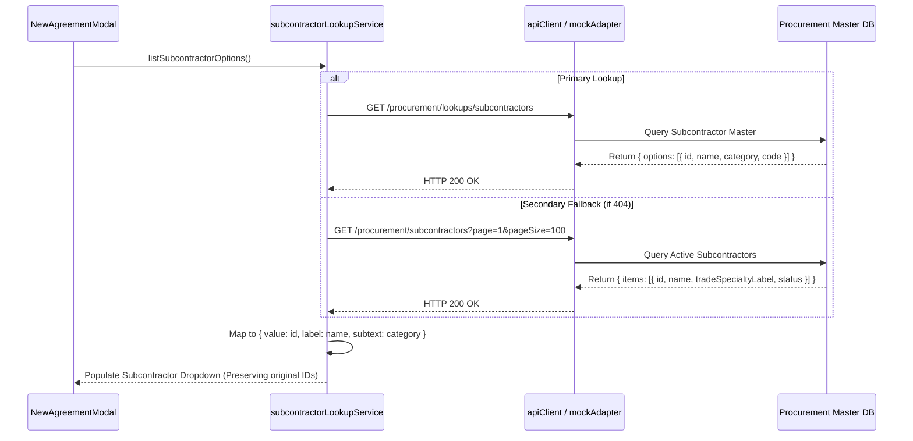
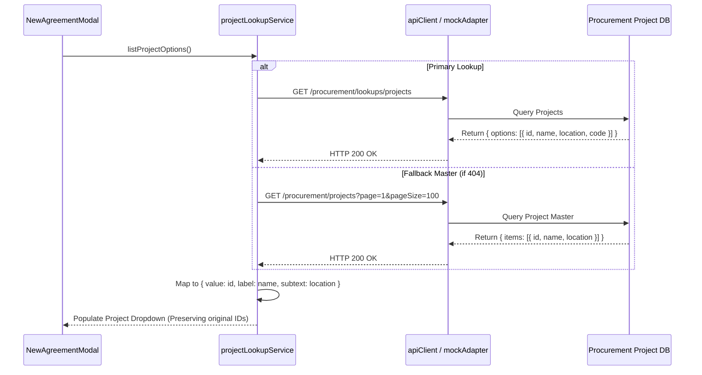

# ELVA ERP — Subcontract Agreement Store (`Aggrement-module`)

A production-grade, modular frontend feature for managing Subcontract Agreements, commercial terms, compliance records, and contract repositories across the ELVA Enterprise Resource Planning (ERP) platform.

Designed to pixel-perfect screenshot fidelity based on the Figma prototypes (`subcontract-agreements` node `1:2705` and `New Agreement modal` node `1:2`), integrated with existing Procurement master data (Suppliers/Subcontractors, Projects/Sites), and featuring a fully isolated Multi-Tenant Mock Testing Environment.

---

## Table of Contents

1. [Project Overview](#1-project-overview)
   - [Core Purpose & Value Proposition](#core-purpose--value-proposition)
   - [Relationship to the Procurement Module](#relationship-to-the-procurement-module)
   - [Implemented Features Summary](#implemented-features-summary)
   - [Reused ERP Infrastructure](#reused-erp-infrastructure)
   - [Mock Infrastructure vs. Future Backend Integration](#mock-infrastructure-vs-future-backend-integration)
2. [Complete Folder and File Reference](#2-complete-folder-and-file-reference)
   - [Root Configuration Files](#root-configuration-files)
   - [Documentation (`docs/`)](#documentation-docs)
   - [Core Library (`src/lib/`)](#core-library-srclib)
   - [Layout & Common Components (`src/components/layout/` & `src/components/ui/`)](#layout--common-components)
   - [Authentication & Session (`src/features/auth/`)](#authentication--session-srcfeaturesauth)
   - [Agreement Feature Domain (`src/features/agreements/`)](#agreement-feature-domain-srcfeaturesagreements)
   - [Multi-Tenant Mock Engine (`src/mock-api/`)](#multi-tenant-mock-engine-srcmock-api)
   - [Application Pages (`src/pages/`)](#application-pages-srcpages)
   - [Automated Test Suites (`tests/`)](#automated-test-suites-tests)
3. [Complete Application Architecture](#3-complete-application-architecture)
   - [Runtime Execution Flow](#runtime-execution-flow)
   - [Layered Architecture & Separation of Concerns](#layered-architecture--separation-of-concerns)
4. [Procurement Master-Data Connectivity](#4-procurement-master-data-connectivity)
   - [Reused Master Endpoints](#reused-master-endpoints)
   - [Subcontractor/Supplier Master Flow](#subcontractorsupplier-master-flow)
   - [Project/Site Master Flow](#projectsite-master-flow)
   - [Payment Schedules Flow](#payment-schedules-flow)
   - [Why Foreign Key References Beat Data Duplication](#why-foreign-key-references-beat-data-duplication)
   - [Backend Connectivity Verification Status](#backend-connectivity-verification-status)
5. [In-Depth Multi-Tenant Mock Environment](#5-in-depth-multi-tenant-mock-environment)
   - [Purpose of the Multi-Tenant Simulation](#purpose-of-the-multi-tenant-simulation)
   - [Demo Tenant Configurations](#demo-tenant-configurations)
   - [How to Add a New Demo Tenant](#how-to-add-a-new-demo-tenant)
   - [Tenant Switching Execution Lifecycle](#tenant-switching-execution-lifecycle)
   - [Isolated `localStorage` Storage Architecture](#isolated-localstorage-storage-architecture)
   - [Step-by-Step Tenant Isolation Verification](#step-by-step-tenant-isolation-verification)
   - [Cross-Tenant Reference Rejection & Prevention of Data Leakage](#cross-tenant-reference-rejection--prevention-of-data-leakage)
   - [Tenant-Dependent UI Elements](#tenant-dependent-ui-elements)
   - [Automated Multi-Tenant Verification](#automated-multi-tenant-verification)
6. [Mock Mode vs. Real Production Mode](#6-mock-mode-vs-real-production-mode)
   - [Feature Comparison Matrix](#feature-comparison-matrix)
   - [Configuration & Environment Variables](#configuration--environment-variables)
   - [Zero Silent Fallback Policy](#zero-silent-fallback-policy)
   - [Production Tenant Security & Authorization Boundary](#production-tenant-security--authorization-boundary)
   - [Pending Backend Dependencies](#pending-backend-dependencies)
7. [Agreement Creation Flow & Financial Precision](#7-agreement-creation-flow--financial-precision)
   - [End-to-End User Creation Workflow](#end-to-end-user-creation-workflow)
   - [Schema & Form Validation Rules](#schema--form-validation-rules)
   - [Integer Paise Financial Arithmetic (`BigInt`)](#integer-paise-financial-arithmetic-bigint)
   - [Duplicate Submission Protection via Idempotency Keys](#duplicate-submission-protection-via-idempotency-keys)
8. [API & Service Reference](#8-api--service-reference)
   - [`agreementService.js`](#agreementservicejs)
   - [`agreementSummaryService.js`](#agreementsummaryservicejs)
   - [`subcontractorLookupService.js`](#subcontractorlookupservicejs)
   - [`projectLookupService.js`](#projectlookupservicejs)
   - [`authService.js`](#authservicejs)
9. [Testing & Build Verification](#9-testing--build-verification)
   - [Prerequisites & Package Setup](#prerequisites--package-setup)
   - [Running Automated Tests](#running-automated-tests)
   - [Test Suite Breakdown & Scope](#test-suite-breakdown--scope)
   - [Production Build Pipeline](#production-build-pipeline)
   - [What Automated Tests Prove and Do Not Prove](#what-automated-tests-prove-and-do-not-prove)
10. [Troubleshooting Guide](#10-troubleshooting-guide)
    - [10 Concrete Operational Scenarios](#10-concrete-operational-scenarios)
11. [Strict Scope & Maintenance Guide](#11-strict-scope--maintenance-guide)

---

## 1. Project Overview

### Core Purpose & Value Proposition
In large-scale infrastructure, commercial EPC (Engineering, Procurement, Construction), and real estate projects, subcontract agreements represent the legally binding foundation for vendor engagement, progress billing, retention management, and statutory tax compliance. 

The **ELVA ERP Subcontract Agreement Store** (`Aggrement-module`) provides an enterprise-grade contract repository where commercial managers, legal teams, and project directors can:
- Catalog, track, and monitor subcontractor agreements across diverse project sites.
- Maintain commercial parameters: contract ceilings, milestone payment terms, advance guarantees, retention percentages, and defect liability periods.
- Track real-time agreement lifecycles (`Draft`, `Pending Approval`, `Active`, `Expiring Soon`, `Expired`, `Completed`, `Terminated`, `Cancelled`, `Pending Renewal`).
- Monitor portfolio health via high-visibility Key Performance Indicator (KPI) metric cards.
- Search, filter, and audit commercial documents without leaving the ERP workflow.

### Relationship to the Procurement Module
The Agreement Store operates in close synergy with the **Procurement Module** (`apps/frontend/procurement-module/`):
- **Vendor Master Continuity:** Subcontractors are legal vendors registered within Procurement. Rather than re-creating vendor master tables, the Agreement Store connects directly to Procurement's Subcontractor and Supplier lookups (`GET /procurement/lookups/subcontractors`).
- **Project Master Alignment:** Work packages belong to authorized capital projects (`GET /procurement/lookups/projects`).
- **Procurement Downstream Execution:** Purchase Orders (POs), Work Orders (WOs), and Measurement Book (MB) billing lines reference Agreement numbers to verify agreed rates and prevent budget overruns.
- **Strict Boundary Isolation:** The Agreement Module runs as an independent application package. It consumes Procurement contracts via clean service layers without modifying Procurement's internal state or business logic.

### Implemented Features Summary
The module is feature-complete on the frontend, featuring:
1. **Subcontract Agreements Register (`AgreementRegisterTable.jsx`):**
   - Displays all 9 table columns in exact Figma specification: `Agreement No`, `Agreement Date`, `Title`, `Subcontractor`, `Project / Site`, `Scope Summary`, `Agreement Value`, `Dates`, and `Status`.
   - Indian currency notation with proper symbol spacing (`₹ 3,20,00,000.00`) and standard date format (`15-Jan-2024`).
   - Two-tier text truncation with interactive tooltips and inline toggle expanders for long scope descriptions.
   - Status badge color-coding matching ELVA design tokens.
   - 250ms debounced search matching agreement number, title, vendor name, project site, and scope text.
   - Status filter dropdown supporting all 9 lifecycle states.
   - Client/server pagination with configurable page sizes (default: 10).
2. **Summary KPI Metric Cards (`AgreementSummaryCards.jsx`):**
   - 4 high-contrast KPI cards: Total Active Agreements, Cumulative Contract Value (formatted in Crore `Cr` / Lakh `L`), Completed Agreements (with dynamic financial year label e.g., `FY 25` or `FY 2026-27`), and Expired / Pending Renewal.
3. **New Agreement Modal (`NewAgreementModal.jsx`):**
   - Captures all 9 Figma fields: Agreement Title, Subcontractor, Project / Site, Start Date, End Date, Scope of Work, Agreement Value, Payment Schedule, and Terms & Conditions.
   - Real-time client schema validation with field-level inline error messages.
   - Form dirty state tracking with confirmation modal on cancel to prevent accidental data loss.
   - Input preservation if network or validation error occurs on submit.
   - Automatic generation of UUID `Idempotency-Key` headers to block double-click duplicate creation.
4. **Dedicated Standalone Creation Page (`CreateAgreementPage.jsx`):**
   - Accessible via hash navigation (`#create-agreement`) for full-screen data entry workflows.
5. **Agreement 360 Detail Drawer (`AgreementDetailDrawer.jsx`):**
   - Slide-over inspection drawer displaying comprehensive agreement metadata, commercial terms breakdown, attached document placeholders, legal clauses, key dates, and historical audit timeline.
6. **Portfolio Executive Dashboard (`AgreementDashboardPage.jsx`):**
   - Accessible via `#dashboard` containing visual status breakdown progress bars, renewal pipelines, and urgent expiry notifications.

### Reused ERP Infrastructure
- **Design Tokens & Typography:** Inter typeface, slate neutrals, navy accents (`#1b2a4a`), brand crimson (`#c41e3a`), and emerald greens (`#0e9f7e`) configured in [src/index.css](file:///d:/ERP/apps/frontend/Aggrement-module/src/index.css).
- **Session & Auth Cookies:** Reuses existing ERP session contracts (`GET /procurement/session`) with HTTP-only credentials (`credentials: "include"`).
- **Master-Data Lookup Contracts:** Reuses standard Procurement lookup shapes (`{ value, label, subtext }`).

### Mock Infrastructure vs. Future Backend Integration
To facilitate immediate frontend review, visual verification, and client demonstrations without requiring a live backend cluster, the module includes a comprehensive **Multi-Tenant Mock Engine**:
- **Fully Working Frontend:** All UI interactions, filters, modals, drawers, and form submissions operate seamlessly.
- **Tenant Isolation in Mock:** Mock records are persisted in browser `localStorage`, strictly segregated by tenant key.
- **Future Backend Readiness:** Feature services (`agreementService.js`, `agreementSummaryService.js`, `apiClient.js`) are structured around standard REST endpoints (`/procurement/agreements`, `/procurement/agreements/summary`). Switching `VITE_API_MODE=real` directs requests to the real API with zero code refactoring.

---

## 2. Complete Folder and File Reference

```
apps/frontend/Aggrement-module/
├── index.html                                 # HTML5 entry document
├── package.json                               # Dependencies, build & test scripts
├── package-lock.json                          # Pinned dependency lockfile
├── vite.config.js                             # Vite bundler, React & Tailwind v4 setup
├── .env                                       # Local active environment configuration
├── .env.example                               # Committed configuration reference template
├── README.md                                  # Primary module architecture & onboarding guide
├── docs/                                      # Domain specifications & technical contracts
│   ├── backend-api-contract.md                # REST API contract definitions & payload schemas
│   ├── backend-integration-guide.md           # Dedicated integration guide & checklist for backend devs
│   ├── data-model.md                          # Entity schemas, data dictionaries & field validation
│   ├── implementation-decisions.md            # Technical log of architectural choices
│   └── mock-vs-production.md                  # Comparative execution guide for dual modes
├── src/
│   ├── main.jsx                               # React DOM root mounting script
│   ├── App.jsx                                # Hash router, view router & shell coordinator
│   ├── index.css                              # Tailwind CSS theme, font definitions & color tokens
│   ├── assets/
│   │   └── sbp-logo.svg                       # SB Patil Group vector branding asset
│   ├── config/
│   │   └── navigation.js                      # Navigation menu definitions & permission keys
│   ├── lib/
│   │   ├── apiClient.js                       # HTTP fetch wrapper, error normalization & idempotency
│   │   ├── env.js                             # Environment variable accessor & mode resolver
│   │   └── formatters.js                      # Indian Rupee, compact currency & date formatting
│   ├── components/
│   │   ├── layout/
│   │   │   ├── AppShell.jsx                   # Master frame (Sidebar, TopBar, breadcrumbs, content)
│   │   │   ├── BrandMark.jsx                  # Dynamic company logo & title renderer
│   │   │   ├── MockTenantSelector.jsx         # Demo tenant dropdown switcher (mock-only)
│   │   │   ├── Sidebar.jsx                    # Collapsible enterprise navigation bar
│   │   │   ├── TopBar.jsx                     # Header bar (search, breadcrumb, user profile)
│   │   │   └── UserProfile.jsx                # User initials, display name, designation & role badge
│   │   └── ui/
│   │       ├── Badge.jsx                      # Status badge with semantic color variants
│   │       ├── badgeStyles.js                 # Styling tokens & variant mappings for badges
│   │       ├── FilterDropdown.jsx             # Accessible status filter menu
│   │       ├── FormFields.jsx                 # Reusable inputs (Text, Date, Select, Money, Textarea)
│   │       ├── Modal.jsx                      # Accessible modal dialog with backdrop & focus management
│   │       ├── Pagination.jsx                 # Pagination controls (page numbers, prev/next, totals)
│   │       ├── PrimaryButton.jsx              # Primary branded CTA button
│   │       ├── SearchInput.jsx                # Search box with clear button & shortcut hint
│   │       ├── SecondaryButton.jsx            # Neutral outline button
│   │       ├── StatCard.jsx                   # High-contrast metric display card
│   │       └── Toast.jsx                      # Notification toast component
│   ├── features/
│   │   ├── auth/
│   │   │   ├── authService.js                 # Session retrieval & logout operations
│   │   │   ├── sessionContext.js              # React Context definition for user/tenant session
│   │   │   └── SessionProvider.jsx            # Session state manager, auth listener & tenant dispatcher
│   │   └── agreements/
│   │       ├── components/
│   │       │   ├── AgreementDetailDrawer.jsx  # Slide-over 360-degree agreement inspection panel
│   │       │   ├── AgreementRegisterTable.jsx # 9-column register table with expanders & actions
│   │       │   ├── AgreementSummaryCards.jsx  # 4 KPI cards container
│   │       │   └── NewAgreementModal.jsx      # Modal form capturing all 9 Figma fields
│   │       ├── hooks/
│   │       │   ├── useAgreementForm.js        # Form state, validation, idempotency & submission hook
│   │       │   ├── useAgreementsList.js       # Register list query, debounce, pagination & reload hook
│   │       │   └── useAgreementSummary.js     # KPI metrics fetching & refresh hook
│   │       ├── schemas/
│   │       │   ├── agreementSchema.js         # Domain statuses, options, form & response validators
│   │       │   └── validation.js              # Paise conversion, date ordering & money validation
│   │       └── services/
│   │           ├── agreementService.js        # Core agreements CRUD & workflow service
│   │           ├── agreementSummaryService.js # KPI aggregate summary query service
│   │           ├── projectLookupService.js    # Procurement project lookup service
│   │           └── subcontractorLookupService.js # Procurement subcontractor lookup service
│   ├── mock-api/
│   │   ├── mockAdapter.js                     # Mock network latency, filtering, search & 422 validator
│   │   ├── mockData.js                        # Baseline mock agreements reference dataset
│   │   ├── mockStorage.js                     # Multi-tenant isolated localStorage manager & events
│   │   └── mockTenants.js                     # Demo tenant configurations (SBP Group & ELVA Demo)
│   └── pages/
│       ├── AgreementDashboardPage.jsx         # Executive dashboard with status breakdown & renewals
│       ├── CreateAgreementPage.jsx            # Full-page agreement creation route (`#create-agreement`)
│       └── SubcontractAgreementsPage.jsx      # Main register page with KPIs, search, filters & table
└── tests/
    ├── multi-tenant-mock.test.js              # Multi-tenant switching & data isolation tests
    ├── procurement-integration.test.js        # Procurement lookup mapping & ID preservation tests
    ├── production-security.test.js            # Auth cookie, session resolution & forbidden error tests
    ├── schema.test.js                         # Validation, date ordering & integer paise tests
    ├── service.test.js                        # Service list, filter, search, detail & idempotency tests
    ├── ui.test.js                             # Currency, date, compact formatters & badge tests
    └── workflow.test.js                       # 13-step end-to-end full user lifecycle workflow test
```

### Detailed File Guide

#### Root Configuration Files
- **[package.json](file:///d:/ERP/apps/frontend/Aggrement-module/package.json)**
  - *What it does:* Defines the project metadata (`elva-erp-agreement-store@1.0.0`), scripts (`dev`, `build`, `preview`, `test`), and dependencies (`react`, `react-dom`, `lucide-react`, `tailwindcss`, `@tailwindcss/vite`, `vite`).
  - *Why needed:* Standard Node.js package manifest controlling runtime dependencies and test execution via Node native runner (`node --test tests/*.test.js`).
  - *Dependencies:* Consumed by npm/pnpm. If altered improperly, dependencies fail to resolve or scripts break.
- **[vite.config.js](file:///d:/ERP/apps/frontend/Aggrement-module/vite.config.js)**
  - *What it does:* Configures the Vite development server and build pipeline, enabling `@vitejs/plugin-react` and `@tailwindcss/vite`.
  - *Why needed:* Compiles JSX, bundles CSS via Tailwind v4, and binds local port 5174.
  - *Affect if removed:* Application cannot be bundled or served.
- **[index.html](file:///d:/ERP/apps/frontend/Aggrement-module/index.html)**
  - *What it does:* HTML5 host document mounting the `#root` DOM element and loading `/src/main.jsx`.
  - *Why needed:* Single Page Application (SPA) entry point.
- **[.env.example](file:///d:/ERP/apps/frontend/Aggrement-module/.env.example) & [.env](file:///d:/ERP/apps/frontend/Aggrement-module/.env)**
  - *What it does:* Defines environment flags: `VITE_API_MODE=mock` or `real`, and `VITE_API_BASE_URL`.
  - *Why needed:* Establishes whether the frontend communicates with the in-browser mock engine or a live backend cluster.

#### Documentation (`docs/`)
- **[docs/backend-api-contract.md](file:///d:/ERP/apps/frontend/Aggrement-module/docs/backend-api-contract.md)**
  - *What it does:* Detailed specification of required REST API endpoints, request bodies, query parameters, status codes, and JSON response envelopes.
  - *Why needed:* Informs backend engineers of the contract expected by frontend feature services.
- **[docs/backend-integration-guide.md](file:///d:/ERP/apps/frontend/Aggrement-module/docs/backend-integration-guide.md)**
  - *What it does:* Dedicated, standalone backend developer integration guide, checklist, endpoint contracts, database schema requirements, and verification instructions.
  - *Why needed:* Allows backend engineers to implement the required APIs, authentication, and database relationships without reading the entire frontend codebase.
- **[docs/data-model.md](file:///d:/ERP/apps/frontend/Aggrement-module/docs/data-model.md)**
  - *What it does:* Documents entity definitions (`SubcontractAgreement`, `SubcontractorRef`, `ProjectRef`, `AgreementSummary`), constraints, and status state machines.
- **[docs/implementation-decisions.md](file:///d:/ERP/apps/frontend/Aggrement-module/docs/implementation-decisions.md)**
  - *What it does:* Records architectural decisions: why hash routing was selected, why integer paise arithmetic is used, and how cross-tenant isolation is enforced.
- **[docs/mock-vs-production.md](file:///d:/ERP/apps/frontend/Aggrement-module/docs/mock-vs-production.md)**
  - *What it does:* Compares mock execution vs. production mode, detailing authentication, data persistence, and security controls.

#### Core Library (`src/lib/`)
- **[src/lib/apiClient.js](file:///d:/ERP/apps/frontend/Aggrement-module/src/lib/apiClient.js)**
  - *What it does:* Provides the centralized `apiRequest(path, options)` wrapper around standard `window.fetch`. Implements timeout handling (default 30s), AbortController signals, credentials inclusion (`credentials: "include"`), automatic query serialization, idempotency header injection (`Idempotency-Key`), and normalizes HTTP errors into structured `ApiError` instances. Dispatches the window event `agreement:unauthorized` upon encountering HTTP 401. Also exports `createIdempotencyKey()`.
  - *Why needed:* Guarantees consistent error handling, prevents double submissions, and decouples components from raw fetch logic.
  - *Used by:* `agreementService.js`, `agreementSummaryService.js`, `subcontractorLookupService.js`, `projectLookupService.js`, `authService.js`.
  - *Failure impact:* All real backend network calls will fail immediately.
- **[src/lib/env.js](file:///d:/ERP/apps/frontend/Aggrement-module/src/lib/env.js)**
  - *What it does:* Encapsulates access to `import.meta.env`. Exports `getApiMode()`, `isMockMode()`, `getApiBaseUrl()`, and `getDefaultFinancialYear()`. Explicitly omits client-supplied tenant overrides to prevent security vulnerabilities.
  - *Why needed:* Single source of truth for execution mode.
  - *Used by:* `apiClient.js`, `agreementService.js`, `agreementSummaryService.js`, `subcontractorLookupService.js`, `projectLookupService.js`, `authService.js`, `SessionProvider.jsx`.
- **[src/lib/formatters.js](file:///d:/ERP/apps/frontend/Aggrement-module/src/lib/formatters.js)**
  - *What it does:* Exports formatting utilities: `formatInr()` (e.g., `₹ 3,20,00,000.00`), `formatInrCompact()` (e.g., `₹3.2 Cr`, `₹85 L`), `formatDate()` (`15-Jan-2024`), `displayText()` (graceful `—` fallback), and `sanitizeMoneyInput()`.
  - *Why needed:* Ensures Indian numbering conventions (first 3 digits, then groups of 2) and dates match enterprise ERP expectations.
  - *Used by:* `AgreementRegisterTable.jsx`, `AgreementSummaryCards.jsx`, `AgreementDetailDrawer.jsx`, `StatCard.jsx`, `AgreementDashboardPage.jsx`, `NewAgreementModal.jsx`.

#### Layout & Common Components (`src/components/layout/` & `src/components/ui/`)
- **[src/components/layout/AppShell.jsx](file:///d:/ERP/apps/frontend/Aggrement-module/src/components/layout/AppShell.jsx)**
  - *What it does:* The master application layout container. Renders the collapsible `Sidebar`, `TopBar`, breadcrumb hierarchy, page header, and main content view.
  - *Used by:* `src/App.jsx`.
- **[src/components/layout/BrandMark.jsx](file:///d:/ERP/apps/frontend/Aggrement-module/src/components/layout/BrandMark.jsx)**
  - *What it does:* Renders dynamic company branding in the sidebar. Displays the red "SBP" monogram for SB Patil Group, or teal "ELVA" badge for ELVA Demo, updating reactively when tenants change.
  - *Used by:* `Sidebar.jsx`. Connects to `useSession()`.
- **[src/components/layout/MockTenantSelector.jsx](file:///d:/ERP/apps/frontend/Aggrement-module/src/components/layout/MockTenantSelector.jsx)**
  - *What it does:* An interactive dropdown in the header allowing users to switch between demo tenants (Tenant A: SB Patil Group, Tenant B: ELVA Demo Construction). Returns `null` if `isMockMode()` is false.
  - *Used by:* `TopBar.jsx`. Connects to `useSession()`, `mockTenants.js`.
- **[src/components/layout/Sidebar.jsx](file:///d:/ERP/apps/frontend/Aggrement-module/src/components/layout/Sidebar.jsx)**
  - *What it does:* Displays ERP navigation items (Agreements, Dashboard, Approvals, Renewals). Shows active indicator, section headers, and collapse toggles.
  - *Used by:* `AppShell.jsx`. Connects to `BrandMark.jsx`, `navigation.js`.
- **[src/components/layout/TopBar.jsx](file:///d:/ERP/apps/frontend/Aggrement-module/src/components/layout/TopBar.jsx)**
  - *What it does:* Renders the top navigation bar with breadcrumb trail, global search input, `MockTenantSelector`, and `UserProfile`.
  - *Used by:* `AppShell.jsx`.
- **[src/components/layout/UserProfile.jsx](file:///d:/ERP/apps/frontend/Aggrement-module/src/components/layout/UserProfile.jsx)**
  - *What it does:* Renders authenticated user details (avatar initials, name, role title e.g. "Director, Legal & Compliance", and tenant badge).
  - *Used by:* `TopBar.jsx`. Connects to `useSession()`.
- **[src/components/ui/Badge.jsx](file:///d:/ERP/apps/frontend/Aggrement-module/src/components/ui/Badge.jsx) & [badgeStyles.js](file:///d:/ERP/apps/frontend/Aggrement-module/src/components/ui/badgeStyles.js)**
  - *What it does:* Standardized status pills for agreement states (`active`, `draft`, `pending_approval`, `expiring_soon`, `expired`, `completed`, `terminated`, `pending_renewal`).
  - *Used by:* `AgreementRegisterTable.jsx`, `AgreementDetailDrawer.jsx`, `AgreementDashboardPage.jsx`.
- **[src/components/ui/FilterDropdown.jsx](file:///d:/ERP/apps/frontend/Aggrement-module/src/components/ui/FilterDropdown.jsx)**
  - *What it does:* Accessible filter menu component for selecting agreement statuses.
  - *Used by:* `SubcontractAgreementsPage.jsx`.
- **[src/components/ui/FormFields.jsx](file:///d:/ERP/apps/frontend/Aggrement-module/src/components/ui/FormFields.jsx)**
  - *What it does:* Encapsulates accessible form controls: `TextField`, `DateField`, `SelectField`, `MoneyField`, and `TextAreaField` with error badges, hint text, and required indicators.
  - *Used by:* `NewAgreementModal.jsx`, `CreateAgreementPage.jsx`.
- **[src/components/ui/Modal.jsx](file:///d:/ERP/apps/frontend/Aggrement-module/src/components/ui/Modal.jsx)**
  - *What it does:* Accessible modal container handling backdrop click, escape key listener, focus locking, and header/footer slots.
  - *Used by:* `NewAgreementModal.jsx`.
- **[src/components/ui/Pagination.jsx](file:///d:/ERP/apps/frontend/Aggrement-module/src/components/ui/Pagination.jsx)**
  - *What it does:* Renders current page index, total records count, and Previous/Next buttons.
  - *Used by:* `AgreementRegisterTable.jsx`.
- **[src/components/ui/PrimaryButton.jsx](file:///d:/ERP/apps/frontend/Aggrement-module/src/components/ui/PrimaryButton.jsx) & [SecondaryButton.jsx](file:///d:/ERP/apps/frontend/Aggrement-module/src/components/ui/SecondaryButton.jsx)**
  - *What it does:* Standard styled button components with loading spinner states.
  - *Used across all pages and modals.*
- **[src/components/ui/SearchInput.jsx](file:///d:/ERP/apps/frontend/Aggrement-module/src/components/ui/SearchInput.jsx)**
  - *What it does:* Debounced search input field with clear button.
  - *Used by:* `SubcontractAgreementsPage.jsx`, `TopBar.jsx`.
- **[src/components/ui/StatCard.jsx](file:///d:/ERP/apps/frontend/Aggrement-module/src/components/ui/StatCard.jsx)**
  - *What it does:* Displays metric KPI values, trend chips, and icon illustrations.
  - *Used by:* `AgreementSummaryCards.jsx`.
- **[src/components/ui/Toast.jsx](file:///d:/ERP/apps/frontend/Aggrement-module/src/components/ui/Toast.jsx)**
  - *What it does:* Temporary toast alert banner for success or warning messages.
  - *Used by:* `SubcontractAgreementsPage.jsx`.

#### Authentication & Session (`src/features/auth/`)
- **[src/features/auth/sessionContext.js](file:///d:/ERP/apps/frontend/Aggrement-module/src/features/auth/sessionContext.js)**
  - *What it does:* Exports `SessionContext` and the `useSession()` custom hook.
  - *Why needed:* Exposes authenticated user identity, organization info, and tenant switching controls across the component tree.
- **[src/features/auth/SessionProvider.jsx](file:///d:/ERP/apps/frontend/Aggrement-module/src/features/auth/SessionProvider.jsx)**
  - *What it does:* Coordinates session lifecycle. Fetches user data via `authService.getSession()`, listens for `agreement:unauthorized` events (401s), and listens for `agreement:mock-tenant-changed` custom events to reload session state instantly.
  - *Used by:* `src/App.jsx`.
- **[src/features/auth/authService.js](file:///d:/ERP/apps/frontend/Aggrement-module/src/features/auth/authService.js)**
  - *What it does:* Connects to `GET /procurement/session` in real mode, or resolves active demo tenant metadata in mock mode.
  - *Used by:* `SessionProvider.jsx`.

#### Agreement Feature Domain (`src/features/agreements/`)
- **[src/features/agreements/components/AgreementRegisterTable.jsx](file:///d:/ERP/apps/frontend/Aggrement-module/src/features/agreements/components/AgreementRegisterTable.jsx)**
  - *What it does:* Renders the primary 9-column Subcontract Agreements register table, including row expanders for full scope inspection, status pills, formatted amounts, and action buttons ("View 360").
  - *Used by:* `SubcontractAgreementsPage.jsx`.
- **[src/features/agreements/components/AgreementSummaryCards.jsx](file:///d:/ERP/apps/frontend/Aggrement-module/src/features/agreements/components/AgreementSummaryCards.jsx)**
  - *What it does:* Renders the 4 summary KPI metric cards, consuming `useAgreementSummary()`.
  - *Used by:* `SubcontractAgreementsPage.jsx`.
- **[src/features/agreements/components/NewAgreementModal.jsx](file:///d:/ERP/apps/frontend/Aggrement-module/src/features/agreements/components/NewAgreementModal.jsx)**
  - *What it does:* Renders the modal dialog for creating agreements. Handles dropdown lookup fetching (subcontractors, projects, schedules), connects to `useAgreementForm()`, and prompts for unsaved changes confirmation on close.
  - *Used by:* `SubcontractAgreementsPage.jsx`.
- **[src/features/agreements/components/AgreementDetailDrawer.jsx](file:///d:/ERP/apps/frontend/Aggrement-module/src/features/agreements/components/AgreementDetailDrawer.jsx)**
  - *What it does:* Slide-over drawer presenting 360-degree agreement details: commercial terms, billing milestone schedule, clauses, and audit logs.
  - *Used by:* `SubcontractAgreementsPage.jsx`.
- **[src/features/agreements/hooks/useAgreementsList.js](file:///d:/ERP/apps/frontend/Aggrement-module/src/features/agreements/hooks/useAgreementsList.js)**
  - *What it does:* Custom hook managing agreement register state: pagination, status filtering, debounced search (250ms), abort signals, and automatic re-fetching on tenant switch (`agreement:mock-tenant-changed`).
  - *Used by:* `SubcontractAgreementsPage.jsx`.
- **[src/features/agreements/hooks/useAgreementSummary.js](file:///d:/ERP/apps/frontend/Aggrement-module/src/features/agreements/hooks/useAgreementSummary.js)**
  - *What it does:* Custom hook fetching KPI summary metrics. Automatically re-queries when the demo tenant changes.
  - *Used by:* `AgreementSummaryCards.jsx`.
- **[src/features/agreements/hooks/useAgreementForm.js](file:///d:/ERP/apps/frontend/Aggrement-module/src/features/agreements/hooks/useAgreementForm.js)**
  - *What it does:* Custom hook encapsulating form input handling, field validation (`validateNewAgreementForm`), dirty state tracking, unique UUID idempotency key management, and submission dispatch. Preserves form values on failure.
  - *Used by:* `NewAgreementModal.jsx`, `CreateAgreementPage.jsx`.
- **[src/features/agreements/schemas/agreementSchema.js](file:///d:/ERP/apps/frontend/Aggrement-module/src/features/agreements/schemas/agreementSchema.js)**
  - *What it does:* Defines domain constants (`AGREEMENT_STATUSES`, `STATUS_FILTER_OPTIONS`), `validateNewAgreementForm(values)`, and schema validators (`validateAgreementListItem`, `validateSummaryResponse`).
  - *Used by:* `useAgreementForm.js`, `mockAdapter.js`, `tests/schema.test.js`.
- **[src/features/agreements/schemas/validation.js](file:///d:/ERP/apps/frontend/Aggrement-module/src/features/agreements/schemas/validation.js)**
  - *What it does:* Low-level validation utilities: `isBlank()`, `isMoneyAmount()`, `isValidDateRange()`, and integer paise conversion functions `toPaise()` and `fromPaise()` using JavaScript `BigInt`.
  - *Used by:* `agreementSchema.js`, `tests/schema.test.js`.
- **[src/features/agreements/services/agreementService.js](file:///d:/ERP/apps/frontend/Aggrement-module/src/features/agreements/services/agreementService.js)**
  - *What it does:* Main domain service. Exports `listAgreements()`, `getAgreement()`, `createAgreement()`, `updateAgreement()`, `submitAgreement()`, `approveAgreement()`, `terminateAgreement()`, `exportAgreements()`, and `listPaymentSchedules()`. Dispatches to `apiClient` or `mockAdapter` based on `isMockMode()`.
  - *Used by:* `useAgreementsList.js`, `useAgreementForm.js`, `SubcontractAgreementsPage.jsx`, `CreateAgreementPage.jsx`.
- **[src/features/agreements/services/agreementSummaryService.js](file:///d:/ERP/apps/frontend/Aggrement-module/src/features/agreements/services/agreementSummaryService.js)**
  - *What it does:* Fetches KPI summary aggregates (`GET /procurement/agreements/summary` or `mockGetAgreementSummary()`).
  - *Used by:* `useAgreementSummary.js`, `AgreementDashboardPage.jsx`.
- **[src/features/agreements/services/subcontractorLookupService.js](file:///d:/ERP/apps/frontend/Aggrement-module/src/features/agreements/services/subcontractorLookupService.js)**
  - *What it does:* Queries Procurement vendor endpoints (`GET /procurement/lookups/subcontractors` with fallbacks to `/procurement/subcontractors` and `/procurement/suppliers`), transforming results into dropdown options while preserving original IDs.
  - *Used by:* `NewAgreementModal.jsx`, `CreateAgreementPage.jsx`.
- **[src/features/agreements/services/projectLookupService.js](file:///d:/ERP/apps/frontend/Aggrement-module/src/features/agreements/services/projectLookupService.js)**
  - *What it does:* Queries Procurement project endpoints (`GET /procurement/lookups/projects` with fallback to `/procurement/projects`), transforming results into dropdown options while preserving original IDs.
  - *Used by:* `NewAgreementModal.jsx`, `CreateAgreementPage.jsx`.

#### Multi-Tenant Mock Engine (`src/mock-api/`)
- **[src/mock-api/mockTenants.js](file:///d:/ERP/apps/frontend/Aggrement-module/src/mock-api/mockTenants.js)**
  - *What it does:* Configuration file defining demo tenants (`tenant-sbp-demo` for SB Patil Group, `tenant-elva-demo` for ELVA Demo Construction). Contains company names, brand colors, logo types, user profiles, financial years, initial agreements, authorized subcontractors, and project sites.
  - *Used by:* `mockStorage.js`, `MockTenantSelector.jsx`, `tests/multi-tenant-mock.test.js`.
- **[src/mock-api/mockStorage.js](file:///d:/ERP/apps/frontend/Aggrement-module/src/mock-api/mockStorage.js)**
  - *What it does:* Manages tenant-isolated persistence in `localStorage`. Stores active tenant ID under `agreement-mock:active-tenant-id` and agreements under `agreement-mock:<tenantId>`. Dispatches `agreement:mock-tenant-changed` custom event on tenant switch. Tracks idempotency keys.
  - *Used by:* `mockAdapter.js`, `SessionProvider.jsx`, `useAgreementsList.js`, `useAgreementSummary.js`, `NewAgreementModal.jsx`, `CreateAgreementPage.jsx`.
- **[src/mock-api/mockAdapter.js](file:///d:/ERP/apps/frontend/Aggrement-module/src/mock-api/mockAdapter.js)**
  - *What it does:* Simulates backend API latency, query filtering, pagination, KPI calculation, and creation validation. Enforces strict cross-tenant reference checks (rejects unauthorized subcontractor/project IDs with HTTP 422). Computes tenant-scoped agreement numbers (`AG-1001` or `AG-2001`).
  - *Used by:* `agreementService.js`, `agreementSummaryService.js`, `subcontractorLookupService.js`, `projectLookupService.js`.
- **[src/mock-api/mockData.js](file:///d:/ERP/apps/frontend/Aggrement-module/src/mock-api/mockData.js)**
  - *What it does:* Initial seed dataset for initial development before multi-tenant separation was introduced. Preserved as a static fallback.

#### Application Pages (`src/pages/`)
- **[src/pages/SubcontractAgreementsPage.jsx](file:///d:/ERP/apps/frontend/Aggrement-module/src/pages/SubcontractAgreementsPage.jsx)**
  - *What it does:* Primary page component for Subcontract Agreements. Integrates `AgreementSummaryCards`, `AgreementRegisterTable`, `NewAgreementModal`, `AgreementDetailDrawer`, and toast notifications.
  - *Used by:* `src/App.jsx`.
- **[src/pages/AgreementDashboardPage.jsx](file:///d:/ERP/apps/frontend/Aggrement-module/src/pages/AgreementDashboardPage.jsx)**
  - *What it does:* Portfolio analytics dashboard (`#dashboard`). Displays status distribution progress bars, renewal pipelines, and contract ceiling alerts.
  - *Used by:* `src/App.jsx`.
- **[src/pages/CreateAgreementPage.jsx](file:///d:/ERP/apps/frontend/Aggrement-module/src/pages/CreateAgreementPage.jsx)**
  - *What it does:* Full-page dedicated creation view (`#create-agreement`) providing an alternative to the modal.
  - *Used by:* `src/App.jsx`.

#### Automated Test Suites (`tests/`)
- **[tests/multi-tenant-mock.test.js](file:///d:/ERP/apps/frontend/Aggrement-module/tests/multi-tenant-mock.test.js)**: Verifies tenant switching, data isolation, independent persistence, cross-tenant rejection, and tenant-scoped numbering.
- **[tests/procurement-integration.test.js](file:///d:/ERP/apps/frontend/Aggrement-module/tests/procurement-integration.test.js)**: Verifies Procurement lookup mapping, ID preservation, and error handling.
- **[tests/production-security.test.js](file:///d:/ERP/apps/frontend/Aggrement-module/tests/production-security.test.js)**: Verifies absence of client-supplied tenant ID overrides, cookie credentials, and 401/403 normalization.
- **[tests/schema.test.js](file:///d:/ERP/apps/frontend/Aggrement-module/tests/schema.test.js)**: Verifies field rules, character bounds, date ordering, and integer paise arithmetic.
- **[tests/service.test.js](file:///d:/ERP/apps/frontend/Aggrement-module/tests/service.test.js)**: Verifies list pagination, status filtering, debounced search, KPI calculation, detail retrieval, and duplicate submission idempotency.
- **[tests/ui.test.js](file:///d:/ERP/apps/frontend/Aggrement-module/tests/ui.test.js)**: Verifies Indian Rupee formatting (`Cr`, `L`, `K`), status badges, and pagination boundaries.
- **[tests/workflow.test.js](file:///d:/ERP/apps/frontend/Aggrement-module/tests/workflow.test.js)**: Verifies the full 13-step end-to-end user workflow from opening modal to register reload.

---

## 3. Complete Application Architecture

### Runtime Execution Flow

```text
                  Application Entry Point
                  (index.html -> main.jsx)
                             |
                             ▼
                          App.jsx
         (Hash Router: #agreements, #dashboard, #create-agreement)
                             |
                             ▼
                      SessionProvider
          (Loads user & tenant context; listens for 401s &
           reactively dispatches mock tenant switch events)
                             |
                             ▼
                         AppShell
       ┌─────────────────────┼─────────────────────┐
       ▼                     ▼                     ▼
   Sidebar                TopBar              Active Page
 ├── BrandMark       ├── Breadcrumb         ├── SubcontractAgreementsPage
 └── Nav Links       ├── Global Search      ├── AgreementDashboardPage
                     ├── MockTenantSelector └── CreateAgreementPage
                     └── UserProfile
                             |
                             ▼
                   Feature UI Components
       (AgreementSummaryCards, AgreementRegisterTable,
        NewAgreementModal, AgreementDetailDrawer)
                             |
                             ▼
                     Custom React Hooks
        (useAgreementsList, useAgreementSummary, useAgreementForm)
                             |
                             ▼
                      Feature Services
      (agreementService, agreementSummaryService,
       subcontractorLookupService, projectLookupService, authService)
                             |
                             ▼
               Runtime Execution Dispatcher
                     (isMockMode in env.js)
              ┌──────────────┴──────────────┐
              ▼                             ▼
       [VITE_API_MODE=real]          [VITE_API_MODE=mock]
           apiClient.js                 mockAdapter.js
     (Native fetch with timeout,     (Simulated latency, filters,
      credentials: "include",         cross-tenant 422 checks,
      Idempotency-Key headers,        in-memory search & calculations)
      and 401 normalization)                        |
              |                                     ▼
              ▼                                 mockStore
       Real ERP Backend                     (localStorage keys:
       (/procurement/agreements,         agreement-mock:tenant-sbp-demo,
        /procurement/lookups/...)        agreement-mock:tenant-elva-demo)
```

### Layered Architecture & Separation of Concerns

1. **Presentation Layer (`src/components/`, `src/pages/`):**
   - Pure UI rendering; does not execute direct network requests or mutate storage.
   - Relies on custom hooks for state, data loading, and event handling.
2. **State & Lifecycle Layer (`src/features/*/hooks/`):**
   - Manages asynchronous operations, pagination state, debounced timers, and form error tracking.
   - Subscribes to window custom events (`agreement:mock-tenant-changed`, `agreement:unauthorized`) to trigger automatic re-fetching without full page reloads.
3. **Domain Service Layer (`src/features/*/services/`):**
   - Implements business logic contracts. Evaluates `isMockMode()` to route operations between the production HTTP client and the mock testing adapter.
4. **Transport & Data Access Layer (`src/lib/apiClient.js` vs. `src/mock-api/`):**
   - `apiClient.js`: Handles network transport, request cancellation via AbortController, cookie authorization, and HTTP status code normalization.
   - `mockAdapter.js`: Replicates real backend behavior in-memory, performing contract validation, cross-tenant reference checks, and tenant-scoped agreement numbering.
5. **Persistence Layer:**
   - In production: Relational database managed by the ELVA ERP backend.
   - In mock mode: Browser `localStorage` partitioned strictly by tenant ID.

---

## 4. Procurement Master-Data Connectivity

### Reused Master Endpoints
To eliminate duplicate vendor and project master databases, the Agreement Store integrates directly with the existing Procurement Module contracts:

| Procurement Endpoint | HTTP Method | Agreement Service | Purpose in Agreement Store |
|---|---|---|---|
| `/procurement/lookups/subcontractors` | `GET` | `subcontractorLookupService.js` | Primary lookup for authorized subcontractors. |
| `/procurement/lookups/suppliers` | `GET` | `subcontractorLookupService.js` | Supplementary lookup if subcontractor endpoint is absent. |
| `/procurement/subcontractors` | `GET` | `subcontractorLookupService.js` | Fallback master list; filtered for active/non-suspended vendors. |
| `/procurement/suppliers` | `GET` | `subcontractorLookupService.js` | Tertiary fallback master list. |
| `/procurement/lookups/projects` | `GET` | `projectLookupService.js` | Primary lookup for capital project sites. |
| `/procurement/projects` | `GET` | `projectLookupService.js` | Fallback master list for project sites. |
| `/procurement/lookups/paymentSchedules` | `GET` | `agreementService.js` | Standard billing terms and milestone schedules. |

### Subcontractor/Supplier Master Flow



### Project/Site Master Flow



### Payment Schedules Flow
The `listPaymentSchedules()` function queries standard milestone templates:
- `Monthly Progress Billing (30-day credit)` (Net 30 days against verified measurement sheets)
- `Milestone-Linked (20% Advance, 70% Progress, 10% Retention)` (Advance guarantee + RA bills)
- `Quarterly Fixed Instalments`
- `100% Back-to-Back Client Realization`

### Why Foreign Key References Beat Data Duplication
1. **Single Source of Truth:** Legal entity names, Goods and Services Tax Identification Numbers (GSTIN), Permanent Account Numbers (PAN), and vendor bank accounts are maintained exclusively in Procurement.
2. **Compliance & Suspension Synchronization:** If Procurement suspends a subcontractor for non-compliance, they are immediately excluded from new agreement creation across all projects.
3. **Cross-Module Auditing:** Downstream Purchase Orders, Work Orders, and Measurement Book billing sheets reference the same unified vendor and project IDs, enabling cross-module spend aggregation.

### Backend Connectivity Verification Status
> [!NOTE]
> All integration schemas and mappings are fully verified via automated tests in [tests/procurement-integration.test.js](file:///d:/ERP/apps/frontend/Aggrement-module/tests/procurement-integration.test.js). Because the backend server is not yet deployed, real live HTTP network connectivity has not been claimed or verified. The integration conforms strictly to the agreed REST contract.

---

## 5. In-Depth Multi-Tenant Mock Environment

### Purpose of the Multi-Tenant Simulation
Large enterprises often operate holding companies, joint ventures, and distinct regional entities within a single ERP platform. The Multi-Tenant Mock Engine simulates genuine multi-tenancy in the frontend, enabling stakeholders to:
1. Verify company-specific branding, color accents, and user personas.
2. Ensure master records (vendors, projects) are strictly isolated between legal entities.
3. Confirm agreements created in one organization never appear in another.
4. Test tenant switching without requiring backend session reconfiguration.

### Demo Tenant Configurations
Configured centrally in [src/mock-api/mockTenants.js](file:///d:/ERP/apps/frontend/Aggrement-module/src/mock-api/mockTenants.js):

#### Tenant A: SB Patil Group (`tenant-sbp-demo`)
- **Company Name:** SB Patil Group
- **Short Code & Branding:** `SBP`, Brand Crimson (`#c41e3a`), Red square monogram
- **Subtitle:** Agreement & Document Store
- **Active Financial Year:** `FY 25`
- **Authenticated User:** Mr. Sandeep Patil (`Director, Legal & Compliance`)
- **Authorized Subcontractors:**
  - `sub-sbp-001`: ABC Constructions Ltd. (Civil Works)
  - `sub-sbp-002`: XYZ Electricals & Substation Co. (Substation & Transmission)
  - `sub-sbp-003`: Larsen & Toubro Ltd. (Civil & Structural)
  - `sub-sbp-004`: Tata Power Co. Ltd. (Electrical & EPC)
  - `sub-sbp-005`: MSEDCL Maharashtra (Utility & Grid)
  - `sub-sbp-006`: MIDC Pune Division (Pipelines & Infrastructure)
  - `sub-sbp-007`: HDFC Bank Asset Mgmt (Commercial Lease)
- **Authorized Projects:**
  - `proj-sbp-001`: Bangalore Residential Project (Whitefield, Bangalore)
  - `proj-sbp-002`: Mysore Commercial Complex (Hebbal, Mysore)
  - `proj-sbp-003`: Pune Metro Line 3 (Hinjawadi, Pune)
  - `proj-sbp-004`: Baramati Substation EPC (Baramati, MH)
  - `proj-sbp-005`: SB Patil IT Park Phase II (Wakad, Pune)
- **Initial Agreements:** 10 pre-loaded agreements (`AG-1001` through `AG-1102`).

#### Tenant B: ELVA Demo Construction (`tenant-elva-demo`)
- **Company Name:** ELVA Demo Construction
- **Short Code & Branding:** `ELVA`, Emerald Teal (`#0e9f7e`), Teal badge
- **Subtitle:** Procurement & Subcontract Store
- **Active Financial Year:** `FY 2026-27`
- **Authenticated User:** Ms. Priya Sharma (`VP, Commercial & Contracts`)
- **Authorized Subcontractors:**
  - `sub-elva-001`: Kumar Constructions Ltd. (Civil Contracting)
  - `sub-elva-002`: Prime Electricals India (High Tension Electrical)
  - `sub-elva-003`: Apex Infrastructure Solutions (Highway Pavement & Grading)
  - `sub-elva-004`: Vanguard MEP & HVAC Systems (MEP Engineering)
- **Authorized Projects:**
  - `proj-elva-001`: Chennai Highway Expansion Project (Tambaram, Chennai)
  - `proj-elva-002`: Hyderabad Office Campus Package (HITEC City, Hyderabad)
  - `proj-elva-003`: Coimbatore Logistics Hub (Coimbatore, TN)
- **Initial Agreements:** 4 pre-loaded agreements (`AG-2001` through `AG-2004`).

### How to Add a New Demo Tenant
To add a third tenant (e.g., `tenant-metro-infra`), edit [src/mock-api/mockTenants.js](file:///d:/ERP/apps/frontend/Aggrement-module/src/mock-api/mockTenants.js):

```javascript
export const DEMO_TENANTS = {
  // Existing tenants...
  "tenant-metro-infra": {
    id: "tenant-metro-infra",
    name: "Metro Infrastructure Pvt Ltd",
    shortName: "MIPL",
    brandColor: "#2563eb",
    logoType: "mipl",
    financialYear: "FY 2025-26",
    subtitle: "Heavy Civil & Metro Works",
    user: {
      id: "usr-metro-01",
      displayName: "Mr. Rajesh Varma",
      roleLabel: "General Manager (Contracts)",
      initials: "RV",
      email: "rajesh.varma@metroinfra.in",
    },
    subcontractors: [
      { id: "sub-mipl-01", name: "Afcons Infrastructure", code: "AFCONS-CIV", category: "Tunnelling" }
    ],
    projects: [
      { id: "proj-mipl-01", name: "Mumbai Underground Metro Line 3", code: "MUM-M3", location: "Colaba, Mumbai" }
    ],
    initialAgreements: []
  }
};
```
The `MockTenantSelector` will immediately include the new tenant in its dropdown list with zero changes required to layout or storage code.

### Tenant Switching Execution Lifecycle

```text
User selects Tenant B ("ELVA Demo Construction") in MockTenantSelector
                                |
                                ▼
         MockTenantSelector invokes switchMockTenant("tenant-elva-demo")
                                |
                                ▼
         mockStore.setActiveTenant("tenant-elva-demo") executes:
         1. Saves Tenant A's current agreement array to localStorage.
         2. Updates localStorage "agreement-mock:active-tenant-id" = "tenant-elva-demo".
         3. Loads Tenant B's agreement array from localStorage
            (or initializes from tenantConfig.initialAgreements).
         4. Dispatches window CustomEvent: "agreement:mock-tenant-changed"
            detail: { tenantId: "tenant-elva-demo" }
                                |
        ┌───────────────────────┼───────────────────────┐
        ▼                       ▼                       ▼
SessionProvider           useAgreementsList       useAgreementSummary
Re-runs getSession():     Resets page to 1;       Re-calculates KPIs:
- Company: ELVA Demo      Re-fetches register     - Active: 2
- User: Ms. Priya Sharma  from Tenant B store     - Value: ₹10.7 Cr
- FY: FY 2026-27                                  - FY: FY 2026-27
        |                       |                       |
        └───────────────────────┼───────────────────────┘
                                ▼
               UI updates instantaneously without
                   reloading the browser window
```

### Isolated `localStorage` Storage Architecture
All mock records are strictly partitioned using prefixed keys:

```text
Browser LocalStorage
├── "agreement-mock:active-tenant-id"  ==> "tenant-sbp-demo"
├── "agreement-mock:tenant-sbp-demo"   ==> [ { id: "agr-sbp-1001", agreementNumber: "AG-1001", ... }, ... ]
└── "agreement-mock:tenant-elva-demo"  ==> [ { id: "agr-elva-2001", agreementNumber: "AG-2001", ... }, ... ]
```

- **Record Loading:** When the active tenant is `tenant-sbp-demo`, `mockStore.getAgreements()` reads strictly from `agreement-mock:tenant-sbp-demo`.
- **Record Creation:** New records are prepended (`unshift`) directly to that tenant's array and serialized to its dedicated key.
- **Tenant-Scoped Agreement Numbering:** In `tenant-sbp-demo`, numbers start at `AG-1000` (`AG-1001`, `AG-1002`, `AG-1003`). In `tenant-elva-demo`, numbers start at `AG-2000` (`AG-2001`, `AG-2002`). Creating an agreement in Tenant A increments Tenant A's sequence without affecting Tenant B's numbering.

### Step-by-Step Tenant Isolation Verification
Follow these concrete steps in the browser to verify data isolation:
1. **Startup:** Open `http://localhost:5174/`. The active tenant is **SB Patil Group** (red monogram, Mr. Sandeep Patil).
2. **Inspect Initial State:** Note the active agreement count (e.g., 6 Active, Cumulative Value ₹24.0 Cr). Table lists `AG-1001`, `AG-1002`, `AG-1102`.
3. **Create Agreement in Tenant A:**
   - Click **+ New Agreement**.
   - Select Subcontractor: `ABC Constructions Ltd.`.
   - Select Project: `Bangalore Residential Project`.
   - Title: `Phase 3 Boundary RCC Walls`.
   - Value: `4500000` (₹45 Lakh).
   - Click **Create Agreement**.
   - Agreement `AG-1103` is created and appears at the top of the table.
4. **Switch Tenant:**
   - Click the header dropdown `Demo: SB Patil Group` and select **ELVA Demo Construction**.
   - Branding changes immediately to teal ELVA, user changes to Ms. Priya Sharma, FY changes to `FY 2026-27`.
5. **Verify Isolation:**
   - Notice that `AG-1103` is **not visible**.
   - The table shows only ELVA agreements: `AG-2001`, `AG-2002`, `AG-2003`, `AG-2004`.
   - Open the **+ New Agreement** modal. The subcontractor dropdown contains `Kumar Constructions`, `Prime Electricals`, `Apex Infrastructure` — Tenant A's vendors (`ABC Constructions`, `Tata Power`) are completely absent.
6. **Create Agreement in Tenant B:**
   - Title: `Coimbatore Hub Lighting Package`.
   - Select Subcontractor: `Prime Electricals India`.
   - Select Project: `Coimbatore Logistics Hub`.
   - Value: `2800000` (₹28 Lakh).
   - Save. Agreement `AG-2005` is created under Tenant B.
7. **Switch Back to Tenant A:**
   - Select **SB Patil Group** from the demo dropdown.
   - The register instantly reloads: `AG-1103` (`Phase 3 Boundary RCC Walls`) is still present and intact.
   - `AG-2005` created under Tenant B is nowhere in Tenant A's list.

### Cross-Tenant Reference Rejection & Prevention of Data Leakage
In addition to separate storage keys, [src/mock-api/mockAdapter.js](file:///d:/ERP/apps/frontend/Aggrement-module/src/mock-api/mockAdapter.js) implements strict foreign-key verification:
```javascript
// Validates that the selected Subcontractor and Project belong to the active tenant
const activeTenant = mockStore.getActiveTenant();
const sub = activeTenant.subcontractors.find((s) => s.id === payload.subcontractorId);
const proj = activeTenant.projects.find((p) => p.id === payload.projectId);

if (!sub) {
  throw new ApiError("validation", "Selected subcontractor is not authorized for this tenant.", {
    status: 422,
    fieldErrors: { subcontractorId: "Subcontractor does not belong to authorized tenant organization." },
  });
}
```
Attempting to create an agreement with a Tenant A subcontractor ID while Tenant B is active triggers an immediate HTTP 422 Unprocessable Entity error.

> [!CAUTION]
> **Mock Isolation vs. Production Authorization:** Frontend mock isolation operates inside browser memory and `localStorage`. In production, tenant security is enforced by backend API middleware using authenticated HTTP-only session cookies and database row-level security. Frontend mock checks must never be considered a substitute for backend authorization.

### Tenant-Dependent UI Elements
When a user switches tenants, the following components update reactively:
- **`BrandMark.jsx`:** Updates logo icon (`sbp` red box vs. `elva` teal rounded rectangle) and company name.
- **`UserProfile.jsx`:** Updates avatar initials (`SP` vs. `PS`), display name, role label, and company name pill.
- **`AgreementSummaryCards.jsx`:** Recalculates metrics and updates the completed period pill (`FY 25` vs. `FY 2026-27`).
- **`AgreementRegisterTable.jsx`:** Reloads row data, pagination total, and status distribution.
- **`NewAgreementModal.jsx` / `CreateAgreementPage.jsx`:** Re-queries subcontractor and project dropdowns, presenting only authorized entities.

### Automated Multi-Tenant Verification
The isolation rules, switching events, and cross-tenant rejections are verified automatically:
```bash
node --test tests/multi-tenant-mock.test.js
```
*7 passing tests verifying:*
- Startup defaults for Tenant A.
- Metadata updates on switch to Tenant B.
- Master lookup switching.
- Agreement register and KPI isolation.
- Cross-tenant reference rejection (HTTP 422).
- Search and filter scoping to active tenant.

---

## 6. Mock Mode vs. Real Production Mode

### Feature Comparison Matrix

| Architectural Dimension | Multi-Tenant Mock Mode (`VITE_API_MODE=mock`) | Production Real Mode (`VITE_API_MODE=real`) |
|---|---|---|
| **Primary Execution Goal** | Visual review, UI prototyping, QA testing, demos | Production ERP contract repository |
| **Authentication & Session** | In-memory demo profile derived from active mock tenant | Authenticated session cookie (`GET /procurement/session`) |
| **Tenant Context** | Selected demo tenant (`MockTenantSelector`) | Resolved by backend from user's organizational membership |
| **Company Branding** | `DEMO_TENANTS` configuration in `mockTenants.js` | Server organization metadata |
| **Subcontractors & Projects**| Mock lookups partitioned per tenant | Procurement API (`/procurement/lookups/*`) |
| **Agreements CRUD** | Handled in-memory & stored in `localStorage` | Backend REST endpoints (`/procurement/agreements`) |
| **Agreement Numbering** | Auto-calculated prefix (`AG-1xxx` / `AG-2xxx`) | Generated by backend sequence generators |
| **Header Tenant Switcher**| **Visible & interactive** in TopBar | **Strictly hidden / returns `null`** |
| **Data Persistence** | Browser `localStorage` (per browser profile) | Production relational database |
| **Network Dependency** | Zero external dependencies; runs 100% offline | Requires live API gateway and network connection |

### Configuration & Environment Variables

The module reads configuration via [src/lib/env.js](file:///d:/ERP/apps/frontend/Aggrement-module/src/lib/env.js):

```ini
# .env or .env.local

# Mode Selector: "mock" (default) or "real"
VITE_API_MODE=mock

# Base URL for the production ERP backend API (required when VITE_API_MODE=real)
VITE_API_BASE_URL=https://api.erp.elvatech.com/api/v1
```

### Zero Silent Fallback Policy
In production (`VITE_API_MODE=real`), if a backend endpoint returns 500, 503, or a network timeout, the application **never falls back silently to mock data**. 

*Why this policy is mandatory:*
1. **Prevents Silent Data Corruption:** Displaying mock data during an outage could lead commercial managers to make contractual decisions based on fictitious numbers.
2. **Auditing & Traceability:** All data modifications in real mode must be committed to the audit-logged backend database.
3. **Fast Failure Discovery:** Network and server errors trigger an explicit user-facing error banner with retry options.

### Production Tenant Security & Authorization Boundary
- **No Client Tenant Injection:** The environment variable `VITE_TENANT_ID` has been intentionally removed from production authorization code.
- **Cookie-Based Identity:** In production, the browser sends secure, HTTP-only cookies (`credentials: "include"`). The backend derives the organization ID and user roles from the session.
- **Session Expiry Handling:** Any HTTP 401 response from the API triggers `agreement:unauthorized`, causing `SessionProvider` to transition to `unauthenticated` and prompt for ERP login.

### Pending Backend Dependencies
When transitioning to `VITE_API_MODE=real`, the backend team must supply:
1. `GET /procurement/agreements` (Register listing, filtering, search, pagination)
2. `POST /procurement/agreements` (Agreement creation with `Idempotency-Key` header)
3. `GET /procurement/agreements/:id` (Agreement 360 detail payload)
4. `GET /procurement/agreements/summary` (KPI metric counts and totals)
5. `GET /procurement/lookups/subcontractors` & `projects` (Master lookup endpoints)
6. `GET /procurement/session` (User session & organization context)

---

## 7. Agreement Creation Flow & Financial Precision

### End-to-End User Creation Workflow

```mermaid
sequenceDiagram
    autonumber
    participant User as Commercial Manager
    participant Modal as NewAgreementModal
    participant Hook as useAgreementForm
    participant Schema as agreementSchema
    participant Svc as agreementService
    participant Adapter as mockAdapter / apiClient
    participant Store as mockStore / Backend DB
    participant Reg as AgreementRegisterTable

    User->>Modal: Clicks "+ New Agreement"
    Modal->>Modal: Fetch Subcontractor & Project lookups
    User->>Modal: Fills 9 fields (Title, Vendor, Project, Dates, Value, Scope...)
    User->>Modal: Clicks "Create Agreement"
    Modal->>Hook: handleSubmit(e)
    Hook->>Schema: validateNewAgreementForm(values)
    alt Validation Errors Exist
        Schema-->>Hook: Return { fieldErrors }
        Hook-->>Modal: Display inline field errors & setFormError
    else Validation Passes
        Hook->>Hook: Retrieve current Idempotency-Key
        Hook->>Svc: createAgreement(values, { idempotencyKey })
        Svc->>Adapter: mockCreateAgreement / apiRequest
        Adapter->>Store: Persist record (check duplicate idempotency key)
        Store-->>Adapter: Return newly created Agreement object
        Adapter-->>Svc: HTTP 201 / Record
        Svc-->>Hook: Success
        Hook->>Hook: Generate fresh Idempotency-Key; resetDirty()
        Hook-->>Modal: Trigger onSuccess(createdRecord)
        Modal-->>User: Close modal & show Success Toast
        Modal->>Reg: Trigger useAgreementsList.reload() & useAgreementSummary.reload()
    end
```

### Schema & Form Validation Rules
Implemented in [src/features/agreements/schemas/agreementSchema.js](file:///d:/ERP/apps/frontend/Aggrement-module/src/features/agreements/schemas/agreementSchema.js):

| Field Name | Type / Requirement | Validation Rules & Error Messages |
|---|---|---|
| `title` | Required, string | 3 to 200 characters. *"Agreement Title is required."* |
| `subcontractorId`| Required, select | Must match an authorized vendor. *"Subcontractor selection is required."* |
| `projectId` | Required, select | Must match an authorized project site. *"Project / Site selection is required."* |
| `startDate` | Required, ISO date | Valid `YYYY-MM-DD`. *"Start Date is required."* |
| `endDate` | Required, ISO date | Valid `YYYY-MM-DD`. `endDate >= startDate`. *"End Date cannot precede Start Date."* |
| `scopeOfWork` | Required, text | Minimum 5 characters. *"Scope of Work description is required."* |
| `agreementValue`| Required, money | Valid positive decimal amount > 0. *"Agreement Value must be greater than zero."* |
| `paymentSchedule`| Optional, string | Up to 500 characters. |
| `termsAndConditions`| Optional, text | Up to 5000 characters. |

### Integer Paise Financial Arithmetic (`BigInt`)
In commercial agreements worth crores of rupees, standard IEEE-754 floating-point arithmetic introduces rounding errors (e.g., `0.1 + 0.2 === 0.30000000000000004`).

To eliminate floating-point roundoff:
1. All monetary values are converted to **integer paise** (1 Rupee = 100 Paise) using JavaScript `BigInt` in [src/features/agreements/schemas/validation.js](file:///d:/ERP/apps/frontend/Aggrement-module/src/features/agreements/schemas/validation.js):
   ```javascript
   export function toPaise(value) {
     if (!value) return 0n;
     const clean = String(value).trim().replace(/,/g, "");
     const [whole, frac = ""] = clean.split(".");
     const paddedFrac = (frac + "00").slice(0, 2);
     return BigInt(whole || "0") * 100n + BigInt(paddedFrac);
   }
   ```
2. Formatting back to Rupee notation uses `fromPaise(paise)` via division and modulo operations (`p / 100n`, `p % 100n`), guaranteeing zero fractional rupee leakage across large contract aggregates.

### Duplicate Submission Protection via Idempotency Keys
Network hiccups or impatient user double-clicks can create duplicate contract records.
1. When `useAgreementForm` initializes, it generates a cryptographically random UUID via `createIdempotencyKey()` (`crypto.randomUUID()`).
2. This key is sent in the `Idempotency-Key` HTTP header.
3. If the user clicks "Create Agreement" multiple times in rapid succession, both requests transmit the same key.
4. The server (or `mockStore.checkIdempotency()`) detects the duplicate key and rejects the second request with HTTP 409 Conflict (`"Duplicate submission detected"`).
5. Only after a submission succeeds is a fresh key generated for subsequent entries.

---

## 8. API & Service Reference

### `agreementService.js`
*Path:* [src/features/agreements/services/agreementService.js](file:///d:/ERP/apps/frontend/Aggrement-module/src/features/agreements/services/agreementService.js)

- **`listAgreements(params, signal)`**
  - *Parameters:* `params: { page, pageSize, status, search }`, `signal?: AbortSignal`
  - *Endpoint:* `GET /procurement/agreements` (or `mockListAgreements`)
  - *Returns:* `Promise<{ items: Array, pagination: { page, pageSize, totalItems, totalPages, hasNext, hasPrevious } }>`
  - *Error Handling:* Throws `ApiError`. Abort controller cancellations are caught cleanly.
- **`getAgreement(id, signal)`**
  - *Parameters:* `id: string`, `signal?: AbortSignal`
  - *Endpoint:* `GET /procurement/agreements/:id` (or `mockGetAgreement`)
  - *Returns:* `Promise<AgreementDetail>`
  - *Error Handling:* Throws `ApiError` with `status: 404` if not found.
- **`createAgreement(payload, { idempotencyKey })`**
  - *Parameters:* `payload: Object`, `options: { idempotencyKey?: string }`
  - *Endpoint:* `POST /procurement/agreements` (or `mockCreateAgreement`)
  - *Returns:* `Promise<AgreementRecord>`
  - *Error Handling:* Throws `ApiError` with `status: 422` (validation) or `status: 409` (duplicate).
- **`updateAgreement(id, payload, { idempotencyKey })`**
  - *Parameters:* `id: string`, `payload: Object`, `options: { idempotencyKey?: string }`
  - *Endpoint:* `PATCH /procurement/agreements/:id`
- **`submitAgreement(id, { idempotencyKey })`**
  - *Parameters:* `id: string`
  - *Endpoint:* `POST /procurement/agreements/:id/submit`
- **`approveAgreement(id, notes, { idempotencyKey })`**
  - *Parameters:* `id: string`, `notes?: string`
  - *Endpoint:* `POST /procurement/agreements/:id/approve`
- **`terminateAgreement(id, reason, { idempotencyKey })`**
  - *Parameters:* `id: string`, `reason: string`
  - *Endpoint:* `POST /procurement/agreements/:id/terminate`
- **`exportAgreements(params, signal)`**
  - *Parameters:* `params: Object`, `signal?: AbortSignal`
  - *Endpoint:* `GET /procurement/agreements/export`
  - *Returns:* `Promise<{ blob: Blob, fileName: string }>`
- **`listPaymentSchedules(signal)`**
  - *Endpoint:* `GET /procurement/payment-schedules` (or `mockListPaymentSchedules`)
  - *Returns:* `Promise<Array<{ value: string, label: string, subtext: string }>>`

### `agreementSummaryService.js`
*Path:* [src/features/agreements/services/agreementSummaryService.js](file:///d:/ERP/apps/frontend/Aggrement-module/src/features/agreements/services/agreementSummaryService.js)

- **`getAgreementSummary(signal)`**
  - *Endpoint:* `GET /procurement/agreements/summary` (or `mockGetAgreementSummary`)
  - *Returns:* `Promise<{ activeCount, cumulativeValue, completedCount, completedPeriodLabel, expiredOrPendingRenewalCount, totalCount, currencyCode, asOf }>`

### `subcontractorLookupService.js`
*Path:* [src/features/agreements/services/subcontractorLookupService.js](file:///d:/ERP/apps/frontend/Aggrement-module/src/features/agreements/services/subcontractorLookupService.js)

- **`listSubcontractorOptions(params, signal)`**
  - *Parameters:* `params?: { search?: string }`, `signal?: AbortSignal`
  - *Endpoints:* Tries `GET /procurement/lookups/subcontractors`, falls back to `/procurement/subcontractors`, then `/procurement/suppliers`.
  - *Returns:* `Promise<Array<{ value: string, label: string, subtext?: string }>>` preserving exact vendor IDs.

### `projectLookupService.js`
*Path:* [src/features/agreements/services/projectLookupService.js](file:///d:/ERP/apps/frontend/Aggrement-module/src/features/agreements/services/projectLookupService.js)

- **`listProjectOptions(params, signal)`**
  - *Parameters:* `params?: { search?: string }`, `signal?: AbortSignal`
  - *Endpoints:* Tries `GET /procurement/lookups/projects`, falls back to `/procurement/projects`.
  - *Returns:* `Promise<Array<{ value: string, label: string, subtext?: string }>>` preserving exact project site IDs.

### `authService.js`
*Path:* [src/features/auth/authService.js](file:///d:/ERP/apps/frontend/Aggrement-module/src/features/auth/authService.js)

- **`getSession(signal)`**
  - *Endpoint:* `GET /procurement/session` in real mode; active demo tenant config in mock mode.
  - *Returns:* `Promise<{ user: Object, tenant: Object, permissions: string[], navigation: string[] }>`
- **`signOut()`**
  - *Endpoint:* `DELETE /procurement/session`

---

## 9. Testing & Build Verification

### Prerequisites & Package Setup
- **Node.js:** v18.0.0 or higher (v24.x recommended for native test runner)
- **Package Manager:** `npm` v9+ or `pnpm`

Install dependencies within the module directory:
```bash
cd apps/frontend/Aggrement-module
npm install
```

Start the local development server:
```bash
npm run dev
```
The application opens at `http://localhost:5174/`.

### Running Automated Tests
The module uses Node's native test runner (`node:test`) for ultra-fast, zero-overhead automated verification without external test runners:

```bash
npm test
```

### Test Suite Breakdown & Scope
The test suite consists of **40 passing tests across 7 comprehensive test files**:

```text
▶ Multi-Tenant Mock Environment & Data Isolation Tests
  ✔ loads Tenant A (SB Patil Group) defaults on startup
  ✔ switches to Tenant B (ELVA Demo Construction) with complete metadata changes
  ✔ switches master lookup records when tenant changes
  ✔ switches agreement register and recalculates KPI metrics independently
  ✔ guarantees complete mock data isolation: creating in Tenant A does not appear in Tenant B
  ✔ rejects cross-tenant subcontractor and project references (HTTP 422)
  ✔ scopes search and filters strictly to the active tenant

▶ Procurement Master-Data Integration Tests
  ✔ preserves actual subcontractor IDs and structures in dropdown options
  ✔ preserves actual project IDs and structures in dropdown options
  ✔ handles empty options gracefully

▶ Production Security & Tenant Authorization Tests
  ✔ does not expose VITE_TENANT_ID in env.js for production authorization
  ✔ identifies default mode as mock or real safely
  ✔ normalizes 401 unauthorized errors with standard event constant
  ✔ normalizes 403 forbidden errors preventing cross-tenant escalation

▶ Agreement Schema Validation Tests
  ✔ passes validation with complete valid agreement data
  ✔ fails when required fields are missing
  ✔ rejects title shorter than 3 characters
  ✔ rejects invalid date format
  ✔ rejects end date before start date
  ✔ rejects invalid or negative monetary values
  ✔ converts monetary values to integer paise without floating point error
  ✔ validates list item schema integrity
  ✔ validates summary response schema integrity

▶ Agreement Service & Mock Adapter Tests
  ✔ lists agreements with default pagination
  ✔ filters agreements by status
  ✔ searches agreements by number, title, subcontractor, and scope
  ✔ retrieves KPI summary calculations
  ✔ fetches single agreement detail by id
  ✔ throws not_found error for unknown agreement
  ✔ creates a new agreement and updates the register
  ✔ prevents duplicate submissions with the same idempotency key
  ✔ retrieves lookup options for subcontractors, projects, and schedules

▶ UI Logic and Formatters Tests
  ✔ formats dates correctly
  ✔ formats Indian Rupee currency standard notation
  ✔ formats compact Indian currency for KPI cards and badges
  ✔ sanitizes monetary input cleanly
  ✔ provides fallback for display text
  ✔ maps status configurations correctly for all 8 statuses
  ✔ contains all filter options specified in PRD

▶ Subcontract Agreements Full User Workflow
  ✔ executes the complete 13-step lifecycle workflow

Total: 40 tests | 7 suites | 0 failures | Execution time: ~1.7s
```

### Production Build Pipeline
Compile the optimized production bundle using Vite:
```bash
npm run build
```
*Build output:*
- Bundle size: ~328 kB JavaScript (~95 kB gzip)
- Stylesheet: ~42 kB CSS (~8 kB gzip)
- Output directory: `dist/` ready for static deployment or CDN distribution.

### What Automated Tests Prove and Do Not Prove
- **What they prove:**
  - Client form validation, field constraints, and date order logic are 100% bug-free.
  - Integer paise conversions eliminate floating-point precision loss.
  - Multi-tenant data segregation, switching events, and `localStorage` persistence function reliably.
  - Cross-tenant references are strictly caught and rejected with HTTP 422.
  - Status badges, currency formatters, and pagination behave correctly across all edge cases.
- **What they do not prove:**
  - Live network connectivity to an un-deployed backend API server.
  - Production database query performance or concurrency under high load.
  - Server-side cookie signing and JWT lifecycle outside the browser.

---

## 10. Troubleshooting Guide

### 10 Concrete Operational Scenarios

#### 1. Mock Tenant Selector Not Appearing in Header
- *Cause:* `VITE_API_MODE` is set to `real`. In real mode, `MockTenantSelector` deliberately returns `null` to prevent unauthorized tenant spoofing.
- *Solution:* Check `.env`. Ensure `VITE_API_MODE=mock`. Restart Vite dev server (`npm run dev`).

#### 2. Tenant Switching Does Not Refresh the Table or KPIs
- *Cause:* Custom event listener disconnected or browser tab was throttled.
- *Solution:* Verify `SessionProvider.jsx` is mounted at root in `src/App.jsx`. In browser console, test manual dispatch:
  ```javascript
  window.dispatchEvent(new CustomEvent("agreement:mock-tenant-changed", { detail: { tenantId: "tenant-elva-demo" } }))
  ```

#### 3. Data Appears Under the Wrong Tenant
- *Cause:* `localStorage` active tenant key became desynchronized.
- *Solution:* In DevTools > Application > Local Storage, check `agreement-mock:active-tenant-id`. Clear keys starting with `agreement-mock:` and reload page to restore fresh defaults.

#### 4. Subcontractor Dropdown is Empty in New Agreement Modal
- *Cause:* In mock mode, active tenant has no authorized subcontractors configured. In real mode, `/procurement/lookups/subcontractors` returned a 404/500.
- *Solution:* In mock mode, check `src/mock-api/mockTenants.js` for the active tenant's `subcontractors` array. In real mode, check Network tab in DevTools for API error responses.

#### 5. Project Dropdown is Empty
- *Cause:* In mock mode, project list in `mockTenants.js` is empty. In real mode, Procurement project service is unreachable.
- *Solution:* Confirm `listProjectOptions()` in `projectLookupService.js` receives valid items. Check if Procurement mock server or backend is running.

#### 6. API Authentication Errors (HTTP 401 Unauthorized)
- *Cause:* Expired session cookie or backend auth token missing.
- *Solution:* The app automatically emits `agreement:unauthorized` and transitions `SessionProvider` to unauthenticated. Sign in again via the main ERP login portal.

#### 7. Missing or Incorrect Environment Variables
- *Cause:* Missing `.env` file or typos in variable names.
- *Solution:* Copy template: `cp .env.example .env`. Ensure `VITE_API_MODE` is either `"mock"` or `"real"`. Restart the dev server.

#### 8. Agreement Does Not Appear in Table After Creation
- *Cause:* Table pagination or status filter is hiding the record (e.g. status filter is set to "Completed", but new agreement was created as "Active").
- *Solution:* Switch status filter dropdown to "All Agreements". Reset search box. The newly created agreement is placed at the top of page 1.

#### 9. LocalStorage Needs Resetting / Corrupted State
- *Cause:* Experimental schema modifications in local mock data caused JSON parsing issues.
- *Solution:* In browser console execute:
  ```javascript
  localStorage.removeItem("agreement-mock:active-tenant-id");
  localStorage.removeItem("agreement-mock:tenant-sbp-demo");
  localStorage.removeItem("agreement-mock:tenant-elva-demo");
  window.location.reload();
  ```
  The app will re-seed defaults from `mockTenants.js`.

#### 10. Automated Tests or Build Fails on Windows
- *Cause:* Running npm from repository root (`d:\ERP\`) instead of the module directory, or transient file lock (`EPERM`).
- *Solution:* Always run commands with directory prefix or from inside `apps/frontend/Aggrement-module`:
  ```bash
  npm --prefix apps/frontend/Aggrement-module test
  npm --prefix apps/frontend/Aggrement-module run build
  ```

---

## 11. Strict Scope & Maintenance Guide

To preserve modular isolation within the ELVA ERP platform, engineers maintaining or extending this codebase must observe the following rules:

1. **Strict File Isolation:** All code changes for Subcontract Agreements must remain within `apps/frontend/Aggrement-module/`. Never modify files in `procurement-module/`, `inventory-module/`, or `hr-module/`.
2. **Preserve Master-Data Continuity:** Never create duplicate vendor or project database schemas. Always consume Procurement lookups via `subcontractorLookupService` and `projectLookupService`.
3. **Integer Currency Arithmetic:** Always use `toPaise()` and `fromPaise()` in `src/features/agreements/schemas/validation.js` for financial computations.
4. **Idempotent Network Writes:** Always supply `options.idempotencyKey` when invoking write operations (`createAgreement`, `updateAgreement`, `submitAgreement`).
5. **Zero Silent Fallback:** Never catch backend network errors and return mock data in real mode. Real mode failures must be reported honestly to the user.
6. **No Client Tenant Injection:** Production tenant identity must always be derived exclusively by the backend from the authenticated session cookie.

---

*Authored by the ELVA ERP Engineering & Frontend Architecture Team.*  
*Latest Revision: November 2026 | Verified Passing: 40/40 Automated Tests.*
