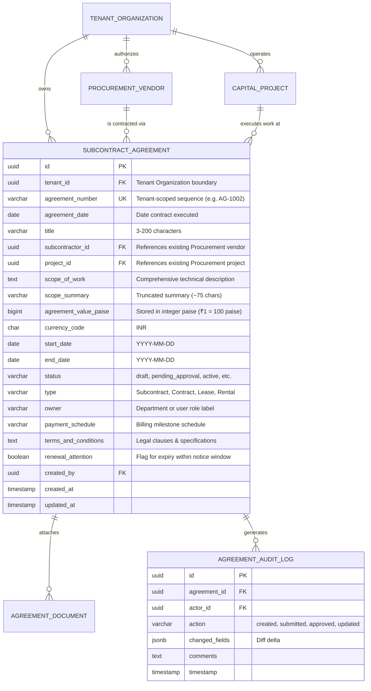

# ELVA ERP — Agreement Module Backend Integration Guide

**Document ID:** ELVA-DOC-AGR-BE-001  
**Target Audience:** Backend Engineers, API Integration Architects, Database Engineers  
**Frontend Module Path:** `apps/frontend/Aggrement-module/`  
**API Specification Reference:** `docs/backend-api-contract.md`  
**Data Model Reference:** `docs/data-model.md`  
**Status:** Comprehensive Integration Guide for Backend Implementation  

---

## Table of Contents

1. [Introduction & Purpose](#1-introduction--purpose)
2. [Frontend Integration Locations](#2-frontend-integration-locations)
3. [Existing Procurement Endpoints (Reused Infrastructure)](#3-existing-procurement-endpoints-reused-infrastructure)
4. [Agreement Backend Endpoints Required](#4-agreement-backend-endpoints-required)
5. [Request and Response Contracts (JSON Examples)](#5-request-and-response-contracts-json-examples)
6. [Database Schema & Relationship Requirements](#6-database-schema--relationship-requirements)
7. [Authentication, Tenant Isolation & Security Architecture](#7-authentication-tenant-isolation--security-architecture)
8. [Mock Mode vs. Real Backend Mode](#8-mock-mode-vs-real-backend-mode)
9. [Backend Implementation Checklist (Prioritized)](#9-backend-implementation-checklist-prioritized)
10. [Step-by-Step Integration & Verification Guide](#10-step-by-step-integration--verification-guide)
11. [Troubleshooting Backend Integration](#11-troubleshooting-backend-integration)

---

## 1. Introduction & Purpose

This integration guide is specifically written for the backend engineer responsible for implementing the APIs, relational data models, security controls, and lifecycle state machines for the **ELVA ERP Subcontract Agreement Store**.

The frontend application (`Aggrement-module`) is fully built, styled to screenshot-level fidelity based on Figma nodes `1:2705` and `1:2`, and verified with 40/40 passing unit and integration tests. It operates today using a multi-tenant in-browser mock engine.

By following this guide, backend developers can:
- Implement the exact REST endpoints expected by frontend services without reading the entire React codebase.
- Maintain zero-duplication master data by referencing existing Procurement vendor and project tables.
- Enforce enterprise multi-tenant security and permission boundaries.
- Seamlessly transition the frontend from `VITE_API_MODE=mock` to `VITE_API_MODE=real`.

---

## 2. Frontend Integration Locations

Below are the exact frontend source files that interact with backend APIs, along with their roles and contract expectations:

| Frontend File Path | Architectural Responsibility | Backend Connection & Expectations |
|---|---|---|
| `src/lib/apiClient.js` | Centralized HTTP fetch wrapper. Handles timeouts (30s), AbortController signals, credentials, `Idempotency-Key` injection, and error normalization. | All HTTP traffic routes through `apiRequest()`. Requires JSON responses or standard error envelopes. Emits `agreement:unauthorized` upon encountering HTTP 401. |
| `src/lib/env.js` | Environment manager. Resolves `VITE_API_MODE` and `VITE_API_BASE_URL`. | Reads `VITE_API_BASE_URL` (e.g., `http://localhost:3000/api/v1`). Explicitly omits client-side tenant parameters. |
| `src/features/auth/authService.js` | Authenticated session provider. | Invokes `GET /procurement/session` with cookies to fetch current user, tenant organization, and permissions. |
| `src/features/auth/SessionProvider.jsx` | React Context provider managing user identity and active tenant. | Listens for `401 Unauthorized` events from `apiClient.js` to trigger ERP login redirection. |
| `src/features/agreements/services/agreementService.js` | Main domain service for agreement operations. | Calls `GET /procurement/agreements` (list), `GET /procurement/agreements/:id` (detail), `POST /procurement/agreements` (create), `PATCH /procurement/agreements/:id` (update), and workflow actions (`/submit`, `/approve`, `/terminate`). |
| `src/features/agreements/services/agreementSummaryService.js` | KPI aggregate metrics provider. | Calls `GET /procurement/agreements/summary` to populate the 4 summary KPI cards in the header. |
| `src/features/agreements/services/subcontractorLookupService.js` | Vendor master lookup service. | Queries `GET /procurement/lookups/subcontractors`, falling back to `/procurement/subcontractors` and `/procurement/suppliers`. |
| `src/features/agreements/services/projectLookupService.js` | Project site master lookup service. | Queries `GET /procurement/lookups/projects`, falling back to `/procurement/projects`. |
| `src/features/agreements/schemas/agreementSchema.js` | Domain validation rules and status definitions. | Validates form fields on the client before submit; backend validation must align with these rules. |
| `src/features/agreements/schemas/validation.js` | Integer paise conversion utilities (`toPaise`, `fromPaise`). | Encapsulates financial arithmetic with zero floating-point loss. |
| `src/features/agreements/hooks/useAgreementForm.js` | Form state machine for agreement creation. | Injects unique UUID `Idempotency-Key` into `createAgreement()` calls. Retains form input upon HTTP 422 or network errors. |
| `src/features/agreements/hooks/useAgreementsList.js` | Table state manager (pagination, 250ms debounced search, status filter). | Dispatches query params (`page`, `pageSize`, `status`, `search`) to `agreementService.listAgreements()`. |
| `src/features/agreements/components/NewAgreementModal.jsx` | Modal dialog capturing the 9 Figma fields. | Consumes `subcontractorLookupService` and `projectLookupService` on mount; submits via `useAgreementForm`. |
| `src/features/agreements/components/AgreementRegisterTable.jsx` | Subcontract Agreements register displaying 9 columns. | Consumes `useAgreementsList`. Renders agreement numbers, vendor names, dates, values, and status badges. |
| `src/pages/AgreementDashboardPage.jsx` | Executive portfolio analytics view (`#dashboard`). | Consumes `useAgreementSummary` for status breakdown progress bars and renewal pipelines. |

---

## 3. Existing Procurement Endpoints (Reused Infrastructure)

The Agreement Module reuses existing Procurement master-data APIs. **The backend developer must NOT create duplicate supplier or project tables.**

### 3.1 `GET /procurement/session`
- **Purpose:** Identifies the logged-in user, their active tenant organization, and granted permissions.
- **Called by:** `src/features/auth/authService.js` (`getSession()`)
- **Query / Body:** None (relies on HTTP-only session cookie or Bearer token).
- **Expected Success Response (200 OK):**
```json
{
  "user": {
    "id": "usr-09823",
    "displayName": "Mr. Sandeep Patil",
    "roleLabel": "Director, Legal & Compliance",
    "initials": "SP",
    "email": "sandeep.patil@sbpatilgroup.com",
    "avatarUrl": null
  },
  "tenant": {
    "id": "tenant-sbp-demo",
    "name": "SB Patil Group",
    "code": "SBP",
    "brandColor": "#c41e3a",
    "logoType": "sbp",
    "financialYear": "FY 25",
    "subtitle": "Agreement & Document Store"
  },
  "permissions": [
    "procurement.agreement.read",
    "procurement.agreement.create",
    "procurement.agreement.update",
    "procurement.agreement.submit",
    "procurement.agreement.approve",
    "procurement.agreement.export"
  ],
  "navigation": ["agreements", "dashboard", "create-agreement"]
}
```

### 3.2 `GET /procurement/lookups/subcontractors`
- **Purpose:** Primary dropdown lookup providing active subcontractors authorized for the active tenant.
- **Called by:** `src/features/agreements/services/subcontractorLookupService.js` (`listSubcontractorOptions()`)
- **Query Parameters:** `search` (optional string)
- **Expected Success Response (200 OK):**
```json
{
  "options": [
    {
      "value": "sub-sbp-001",
      "label": "ABC Constructions Ltd.",
      "subtext": "Civil Works",
      "code": "ABC-CIV"
    },
    {
      "value": "sub-sbp-004",
      "label": "Tata Power Co. Ltd.",
      "subtext": "Electrical & EPC",
      "code": "TATA-EPC"
    }
  ]
}
```
- **How Returned IDs Are Used:** When the user selects a subcontractor, `value` is stored as `subcontractorId` in the Agreement record. The backend must enforce that `subcontractorId` belongs to the authenticated tenant.

### 3.3 `GET /procurement/lookups/suppliers`
- **Purpose:** Supplementary lookup if general suppliers also execute subcontracts.
- **Called by:** `subcontractorLookupService.js` (fallback)
- **Expected Response:** Same `{ options: [{ value, label, subtext }] }` shape as 3.2.

### 3.4 `GET /procurement/subcontractors`
- **Purpose:** Secondary fallback if `/procurement/lookups/subcontractors` is unavailable.
- **Called by:** `subcontractorLookupService.js`
- **Query Parameters:** `page=1&pageSize=100&search=<term>`
- **Expected Success Response (200 OK):**
```json
{
  "items": [
    {
      "id": "sub-sbp-001",
      "name": "ABC Constructions Ltd.",
      "tradeSpecialtyLabel": "Civil Works",
      "code": "ABC-CIV",
      "status": "active"
    }
  ]
}
```
- **Frontend Mapping:** The frontend filters out items where `status === "inactive"` or `"suspended"`.

### 3.5 `GET /procurement/suppliers`
- **Purpose:** Tertiary fallback query against the general vendor master.
- **Called by:** `subcontractorLookupService.js`
- **Query Parameters:** `page=1&pageSize=100&search=<term>`
- **Expected Success Response (200 OK):**
```json
{
  "items": [
    {
      "id": "sup-sbp-009",
      "name": "UltraTech Cement Ltd.",
      "categoryName": "Ready-Mix Concrete",
      "code": "UTC-RMC",
      "status": "active"
    }
  ]
}
```

### 3.6 `GET /procurement/lookups/projects`
- **Purpose:** Primary dropdown lookup providing capital project sites authorized for the active tenant.
- **Called by:** `src/features/agreements/services/projectLookupService.js` (`listProjectOptions()`)
- **Query Parameters:** `search` (optional string)
- **Expected Success Response (200 OK):**
```json
{
  "options": [
    {
      "value": "proj-sbp-001",
      "label": "Bangalore Residential Project",
      "subtext": "Whitefield, Bangalore",
      "code": "BLR-RES-01"
    },
    {
      "value": "proj-sbp-003",
      "label": "Pune Metro Line 3",
      "subtext": "Hinjawadi, Pune",
      "code": "PML-03"
    }
  ]
}
```
- **How Returned IDs Are Used:** When the user selects a project site, `value` is stored as `projectId` in the Agreement record.

### 3.7 `GET /procurement/projects`
- **Purpose:** Fallback list for project sites.
- **Called by:** `projectLookupService.js`
- **Query Parameters:** `page=1&pageSize=100&search=<term>`
- **Expected Success Response (200 OK):**
```json
{
  "items": [
    {
      "id": "proj-sbp-001",
      "name": "Bangalore Residential Project",
      "location": "Whitefield, Bangalore",
      "code": "BLR-RES-01"
    }
  ]
}
```

### 3.8 `GET /procurement/lookups/paymentSchedules` (or `/procurement/payment-schedules`)
- **Purpose:** Provides standard commercial payment schedules for the dropdown.
- **Called by:** `agreementService.listPaymentSchedules()`
- **Expected Success Response (200 OK):**
```json
[
  {
    "id": "ps-01",
    "value": "Monthly Progress Billing (30-day credit)",
    "label": "Monthly Progress Billing (30-day credit)",
    "subtext": "Net 30 days against verified monthly measurement sheets"
  },
  {
    "id": "ps-02",
    "value": "Milestone-Linked (20% Advance, 70% Progress, 10% Retention)",
    "label": "Milestone-Linked (20% Advance, 70% Progress, 10% Retention)",
    "subtext": "20% mobilization advance against BG, 70% RA bills, 10% on completion"
  }
]
```

---

## 4. Agreement Backend Endpoints Required

Below is the complete specification of endpoints that the backend developer must implement for the Agreement Module.

### Endpoint Implementation Checklist

| HTTP Method | Exact Route | Purpose | Frontend Service | Status | Priority |
|---|---|---|---|---|---|
| `GET` | `/procurement/agreements` | List, search, filter, and paginate agreements | `agreementService.listAgreements` | Required | P0 |
| `GET` | `/procurement/agreements/summary` | Return KPI counts and cumulative value | `agreementSummaryService.getAgreementSummary` | Required | P0 |
| `POST` | `/procurement/agreements` | Create draft or active agreement | `agreementService.createAgreement` | Required | P0 |
| `GET` | `/procurement/agreements/:id` | Fetch agreement 360 inspection detail | `agreementService.getAgreement` | Required | P0 |
| `PATCH` | `/procurement/agreements/:id` | Update mutable agreement fields | `agreementService.updateAgreement` | Required | P1 |
| `POST` | `/procurement/agreements/:id/submit` | Submit draft agreement for review | `agreementService.submitAgreement` | Proposed | P1 |
| `POST` | `/procurement/agreements/:id/approve` | Approve agreement workflow step | `agreementService.approveAgreement` | Proposed | P1 |
| `POST` | `/procurement/agreements/:id/reject` | Reject agreement with comments | `agreementService.rejectAgreement` | Proposed | P1 |
| `POST` | `/procurement/agreements/:id/complete`| Mark agreement fulfilled and completed | `agreementService.completeAgreement` | Proposed | P2 |
| `POST` | `/procurement/agreements/:id/terminate`| Terminate agreement with reason | `agreementService.terminateAgreement` | Proposed | P2 |
| `GET` | `/procurement/agreements/:id/documents`| List attached legal documents | Drawer attachment list | Proposed | P2 |
| `POST` | `/procurement/agreements/:id/documents`| Upload agreement PDF / attachment | Drawer document upload | Proposed | P2 |
| `GET` | `/procurement/agreements/:id/history` | Audit trail and revision log | Drawer audit history tab | Proposed | P2 |
| `GET` | `/procurement/agreements/export` | Export filtered agreements to CSV/Excel | `agreementService.exportAgreements` | Required | P1 |

---

### Detailed Endpoint Specifications

#### 4.1 List Agreements
- **Route:** `GET /procurement/agreements`
- **Query Parameters:**
  - `page` (integer, default: 1): 1-indexed page number.
  - `pageSize` (integer, default: 10, max: 100): Records per page.
  - `status` (string, optional): One of `draft`, `pending_approval`, `active`, `expiring_soon`, `expired`, `completed`, `terminated`, `cancelled`, `pending_renewal`. If omitted or empty string, return all statuses.
  - `search` (string, optional): Case-insensitive search string matching agreement number (`AG-1102`), title, subcontractor name, project name, or scope text.
- **Tenant Restriction:** Filter results strictly by the authenticated tenant ID resolved from the session. Never accept `tenantId` as a query parameter.
- **Required Permission:** `procurement.agreement.read`

#### 4.2 Agreement KPI Summary
- **Route:** `GET /procurement/agreements/summary`
- **Calculation Logic:**
  - `activeCount`: Count of records where `status = 'active'` for this tenant.
  - `cumulativeValue`: `SUM(agreementValue)` where `status = 'active'`. Return as a numeric value.
  - `completedCount`: Count of records where `status = 'completed'` within the current financial year.
  - `completedPeriodLabel`: Financial year label for the tenant (e.g., `"FY 25"` or `"FY 2026-27"`).
  - `expiredOrPendingRenewalCount`: Count of records where `status IN ('expired', 'pending_renewal')` or where `endDate` is within 60 days of the current date.
  - `totalCount`: Total agreements across all statuses for this tenant.
- **Required Permission:** `procurement.agreement.read`

#### 4.3 Create Agreement
- **Route:** `POST /procurement/agreements`
- **Headers:**
  - `Content-Type: application/json`
  - `Idempotency-Key: <UUID>` (mandatory; check for duplicate submission within a 5-minute sliding window).
- **Request Body:** Exactly the 9 fields captured by Figma:
  - `title` (string, 3–200 chars, required)
  - `subcontractorId` (string, required; must reference an active vendor belonging to the tenant)
  - `projectId` (string, required; must reference an active project site belonging to the tenant)
  - `startDate` (string `YYYY-MM-DD`, required)
  - `endDate` (string `YYYY-MM-DD`, required; `endDate >= startDate`)
  - `scopeOfWork` (string, min 5 chars, required)
  - `agreementValue` (number or decimal string > 0, required; max 2 decimal places)
  - `paymentSchedule` (string, max 500 chars, optional)
  - `termsAndConditions` (string, max 5000 chars, optional)
- **Agreement Number Generation:** Backend must generate a tenant-scoped sequence number (e.g., `AG-1001`, `AG-1002`, `AG-1003`).
- **Required Permission:** `procurement.agreement.create`
- **Tenant Validation:** Must verify that `subcontractorId` and `projectId` belong to the authenticated user's organization. If not, return HTTP 422 with code `INVALID_CROSS_TENANT_REFERENCE`.

#### 4.4 Get Agreement Detail
- **Route:** `GET /procurement/agreements/:id`
- **Path Parameter:** `id` (string; UUID or internal agreement ID).
- **Tenant Restriction:** If the record belongs to another tenant, return HTTP 404 (do NOT reveal its existence via 403).
- **Required Permission:** `procurement.agreement.read`

#### 4.5 Update Agreement
- **Route:** `PATCH /procurement/agreements/:id`
- **Headers:** `Idempotency-Key: <UUID>`
- **Mutable Fields:** `title`, `scopeOfWork`, `agreementValue`, `endDate`, `paymentSchedule`, `termsAndConditions`.
- **Immutable Fields:** `id`, `tenantId`, `agreementNumber`, `agreementDate`, `subcontractorId`, `projectId`. (Modifying vendor or project requires creating an amendment or a new contract).
- **Required Permission:** `procurement.agreement.update`

#### 4.6 Lifecycle Actions (`submit`, `approve`, `reject`, `terminate`)
- **Routes:**
  - `POST /procurement/agreements/:id/submit`
  - `POST /procurement/agreements/:id/approve` (body: `{ "notes": "string" }`)
  - `POST /procurement/agreements/:id/reject` (body: `{ "reason": "string" }`)
  - `POST /procurement/agreements/:id/terminate` (body: `{ "reason": "string" }`)
- **State Machine Transitions:**
  - `draft` -> `pending_approval` (via submit)
  - `pending_approval` -> `active` (via approve)
  - `pending_approval` -> `draft` (via reject)
  - `active` / `expiring_soon` -> `completed` (upon completion date / reconciliation)
  - Any state -> `terminated` (via terminate with logged reason)
- **Permissions:**
  - Submit: `procurement.agreement.submit`
  - Approve/Reject: `procurement.agreement.approve`
  - Terminate: `procurement.agreement.terminate`

#### 4.7 Export Agreements
- **Route:** `GET /procurement/agreements/export`
- **Query Parameters:** Same filters as List Agreements (`status`, `search`).
- **Response:** `200 OK` with `Content-Type: text/csv` (or Excel OpenXML) and `Content-Disposition: attachment; filename="agreements_export_<timestamp>.csv"`.
- **Required Permission:** `procurement.agreement.export`

---

## 5. Request and Response Contracts (JSON Examples)

The following JSON payloads reflect the exact schemas parsed and validated by the frontend.

### 5.1 Agreement Creation Request (`POST /procurement/agreements`)
```json
{
  "title": "Mysore Complex High-Voltage Substation EPC",
  "subcontractorId": "sub-sbp-002",
  "projectId": "proj-sbp-002",
  "startDate": "2024-03-01",
  "endDate": "2026-12-31",
  "scopeOfWork": "Turnkey 66/11 kV internal step-down substation, HT panels, cabling and safety interlocks.",
  "agreementValue": "18500000",
  "paymentSchedule": "Milestone-Linked (20% Advance, 70% Progress, 10% Retention)",
  "termsAndConditions": "Defect liability period of 24 months post commissioning. 5% performance bank guarantee mandatory."
}
```

### 5.2 Agreement Creation Success Response (`201 Created`)
```json
{
  "id": "agr-sbp-1002",
  "tenantId": "tenant-sbp-demo",
  "agreementNumber": "AG-1002",
  "agreementDate": "2024-03-01",
  "title": "Mysore Complex High-Voltage Substation EPC",
  "subcontractor": {
    "id": "sub-sbp-002",
    "name": "XYZ Electricals & Substation Co."
  },
  "projectId": "proj-sbp-002",
  "projectName": "Mysore Commercial Complex",
  "scopeOfWork": "Turnkey 66/11 kV internal step-down substation, HT panels, cabling and safety interlocks.",
  "scopeSummary": "66/11 kV Substation installation & HT cabling",
  "agreementValue": 18500000,
  "currencyCode": "INR",
  "startDate": "2024-03-01",
  "endDate": "2026-12-31",
  "status": "active",
  "type": "Contract",
  "owner": "Electrical Dept",
  "paymentSchedule": "Milestone-Linked (20% Advance, 70% Progress, 10% Retention)",
  "termsAndConditions": "Defect liability period of 24 months post commissioning.",
  "renewalAttention": false,
  "createdAt": "2024-03-01T08:30:00.000Z",
  "updatedAt": "2024-03-01T08:30:00.000Z"
}
```

### 5.3 Agreement List Response (`GET /procurement/agreements`)
```json
{
  "items": [
    {
      "id": "agr-sbp-1001",
      "agreementNumber": "AG-1001",
      "agreementDate": "2024-02-10",
      "title": "Bangalore Towers Foundation Subcontract",
      "subcontractor": {
        "id": "sub-sbp-001",
        "name": "ABC Constructions Ltd."
      },
      "projectId": "proj-sbp-001",
      "projectName": "Bangalore Residential Project",
      "scopeOfWork": "Earthwork, deep excavation, raft foundation, and basement RCC retainment walls.",
      "scopeSummary": "Excavation, raft foundation & basement RCC",
      "agreementValue": 32000000,
      "currencyCode": "INR",
      "startDate": "2024-02-15",
      "endDate": "2026-11-30",
      "status": "active",
      "type": "Subcontract",
      "owner": "Project Dept",
      "renewalAttention": false
    },
    {
      "id": "agr-sbp-1102",
      "agreementNumber": "AG-1102",
      "agreementDate": "2024-01-15",
      "title": "MSEDCL Substation Lease Agreement",
      "subcontractor": {
        "id": "sub-sbp-005",
        "name": "MSEDCL Maharashtra"
      },
      "projectId": "proj-sbp-004",
      "projectName": "Baramati Substation EPC",
      "scopeOfWork": "33/11 kV Electrical substation land lease, grid intertie infrastructure and switchyard rights of way.",
      "scopeSummary": "33/11 kV Electrical substation lease & rights of way",
      "agreementValue": 24000000,
      "currencyCode": "INR",
      "startDate": "2024-01-15",
      "endDate": "2027-04-24",
      "status": "active",
      "type": "Lease",
      "owner": "Project Dept",
      "renewalAttention": true
    }
  ],
  "pagination": {
    "page": 1,
    "pageSize": 10,
    "totalItems": 24,
    "totalPages": 3,
    "hasNext": true,
    "hasPrevious": false
  }
}
```

### 5.4 Agreement KPI Summary Response (`GET /procurement/agreements/summary`)
```json
{
  "activeCount": 18,
  "cumulativeValue": 245000000,
  "completedCount": 6,
  "completedPeriodLabel": "FY 25",
  "expiredOrPendingRenewalCount": 2,
  "totalCount": 26,
  "currencyCode": "INR",
  "tenantId": "tenant-sbp-demo",
  "asOf": "2026-11-03T18:30:00.000Z"
}
```

### 5.5 Agreement Detail 360 Response (`GET /procurement/agreements/:id`)
```json
{
  "id": "agr-sbp-1002",
  "agreementNumber": "AG-1002",
  "agreementDate": "2024-03-01",
  "title": "Mysore Complex High-Voltage Substation EPC",
  "subcontractor": {
    "id": "sub-sbp-002",
    "name": "XYZ Electricals & Substation Co.",
    "code": "XYZ-ELE",
    "gstin": "27AAACX1234F1Z5",
    "contactPerson": "Mr. R. K. Deshmukh",
    "phone": "+91 98220 12345"
  },
  "projectId": "proj-sbp-002",
  "projectName": "Mysore Commercial Complex",
  "projectLocation": "Hebbal, Mysore",
  "scopeOfWork": "Turnkey 66/11 kV internal step-down substation, HT panels, cabling and safety interlocks.",
  "scopeSummary": "66/11 kV Substation installation & HT cabling",
  "agreementValue": 18500000,
  "currencyCode": "INR",
  "startDate": "2024-03-01",
  "endDate": "2026-12-31",
  "status": "active",
  "type": "Contract",
  "owner": "Electrical Dept",
  "paymentSchedule": "Milestone-Linked (20% Advance, 70% Progress, 10% Retention)",
  "termsAndConditions": "Defect liability period of 24 months post commissioning.",
  "renewalAttention": false,
  "commercialTerms": {
    "advancePercentage": 20,
    "retentionPercentage": 10,
    "liquidatedDamagesRate": "0.5% per week delayed, capped at 10%",
    "performanceSecurityType": "Bank Guarantee",
    "performanceSecurityExpiry": "2027-06-30"
  },
  "auditHistory": [
    {
      "timestamp": "2024-03-01T08:30:00.000Z",
      "actorName": "Mr. Sandeep Patil",
      "action": "Created agreement in active status",
      "comments": "Approved against Board Capex Sanction Ref SBP/CAP/2024/09"
    }
  ]
}
```

### 5.6 Standard Error Envelopes

#### Validation Error (`422 Unprocessable Entity` or `400 Bad Request`)
```json
{
  "status": 422,
  "code": "VALIDATION_FAILED",
  "message": "Validation failed. Please correct the highlighted errors.",
  "fieldErrors": {
    "agreementValue": "Agreement Value must be greater than zero.",
    "endDate": "End Date cannot precede the Start Date."
  },
  "requestId": "req-98012-abc"
}
```

#### Unauthorized Response (`401 Unauthorized`)
```json
{
  "status": 401,
  "code": "SESSION_EXPIRED",
  "message": "Your session has expired. Please sign in again.",
  "requestId": "req-401-xyz"
}
```
*Frontend behavior:* Catches 401, dispatches `agreement:unauthorized` window event, and redirects to ERP login.

#### Forbidden Response (`403 Forbidden`)
```json
{
  "status": 403,
  "code": "PERMISSION_DENIED",
  "message": "You do not have permission to approve agreements for this project.",
  "requestId": "req-403-forbidden"
}
```

---

## 6. Database Schema & Relationship Requirements

The backend must adopt a normalized relational schema (PostgreSQL recommended). **Never duplicate vendor or project records.**

### Proposed Entity Relationship Diagram



### Key Database Design Principles
1. **Integer Paise Storage:** `agreement_value_paise` should be a `BIGINT` representing currency in Paise (e.g., ₹18,50,000.00 is stored as `185000000`). This completely eliminates IEEE-754 floating-point errors.
2. **Foreign Key Integrity:** `subcontractor_id` references `procurement_vendors(id)`. `project_id` references `procurement_projects(id)`. Both must share the same `tenant_id` as the agreement.
3. **Tenant-Scoped Unique Numbers:** `CREATE UNIQUE INDEX uq_tenant_agreement_no ON subcontract_agreements(tenant_id, agreement_number);`.
4. **Row-Level Security (RLS):** In PostgreSQL, enable RLS:
   ```sql
   ALTER TABLE subcontract_agreements ENABLE ROW LEVEL SECURITY;
   CREATE POLICY tenant_isolation_policy ON subcontract_agreements
     USING (tenant_id = current_setting('app.current_tenant_id')::uuid);
   ```

---

## 7. Authentication, Tenant Isolation & Security Architecture

### Production Request Execution Flow

```text
               Authenticated ERP User
                         |
                         ▼
             Frontend Agreement Service
     (submits payload without client tenant ID)
                         |
                         ▼
                 Central API Client
       (attaches HTTP-only session cookies &
            unique Idempotency-Key)
                         |
                         ▼
               Backend API Gateway
           (verifies session cookie / JWT)
                         |
                         ▼
            Resolve Authenticated Tenant
     (extracts tenant_id from session context;
     never trusts client headers or URL params)
                         |
                         ▼
             Validate User Permissions
      (verifies procurement.agreement.create,
        read, update, approve for user role)
                         |
                         ▼
     Validate Supplier & Project Authorization
    (confirms subcontractor_id and project_id
     belong to the resolved tenant organization)
                         |
                         ▼
        Execute Relational Database Query
          (applies tenant RLS or WHERE clause)
```

### Security Mandates for the Backend Engineer
1. **Never Accept `tenant_id` from Client:** `VITE_TENANT_ID` has been removed from the frontend. The backend must reject any request attempting to override tenant context via query params or request bodies.
2. **Cross-Tenant Reference Defense:** If a payload contains `subcontractorId: "sub-sbp-001"` but the authenticated user belongs to `tenant-elva-demo`, the backend must reject the request with HTTP 422:
   ```json
   {
     "status": 422,
     "code": "INVALID_CROSS_TENANT_REFERENCE",
     "message": "Selected subcontractor does not belong to your organization."
   }
   ```
3. **Information Disclosure Prevention:** If a user requests `GET /procurement/agreements/:id` for a contract belonging to another tenant, return `404 Not Found` (NOT `403 Forbidden`). This prevents malicious actors from enumerating other tenants' agreement IDs.
4. **Idempotency Enforcement:** Backend must maintain an idempotency table or Redis cache for `Idempotency-Key` headers on `POST /procurement/agreements`. If the same key is received while processing or within 5 minutes of completion, return the cached response or HTTP 409 Conflict.

---

## 8. Mock Mode vs. Real Backend Mode

### Switching the Frontend to Real Mode
To connect the existing frontend to your local or staging backend API:
1. Open [apps/frontend/Aggrement-module/.env](file:///d:/ERP/apps/frontend/Aggrement-module/.env):
   ```ini
   # Switch from "mock" to "real"
   VITE_API_MODE=real

   # Configure your backend API base URL
   VITE_API_BASE_URL=http://localhost:3000/api/v1
   ```
2. Start the frontend:
   ```bash
   npm --prefix apps/frontend/Aggrement-module run dev
   ```
3. Open `http://localhost:5174/`.

### What Changes in Real Mode
- The `MockTenantSelector` in the header **disappears automatically**.
- `SessionProvider` calls `GET /procurement/session` with cookies.
- All CRUD calls route through `src/lib/apiClient.js` to `${VITE_API_BASE_URL}/procurement/agreements`.
- In-memory `localStorage` is bypassed.
- If the backend returns an error, the frontend displays an explicit error message (zero silent fallback).

---

## 9. Backend Implementation Checklist (Prioritized)

To achieve a functioning integrated system as rapidly as possible, implement tasks in this sequence:

### Phase 1: Foundation (P0 — Minimum Viable Integration)
- [ ] **1. Session & Auth Middleware:** Ensure `GET /procurement/session` returns authenticated user, tenant, and agreement permissions.
- [ ] **2. Master-Data Lookups:** Verify `GET /procurement/lookups/subcontractors` and `GET /procurement/lookups/projects` return options matching `{ value, label, subtext }`.
- [ ] **3. Database Schema:** Create `subcontract_agreements` table with foreign keys to existing vendor and project tables.
- [ ] **4. Create Agreement API:** Implement `POST /procurement/agreements` with 9-field validation, sequence generation (`AG-1xxx`), and idempotency check.
- [ ] **5. List Agreements API:** Implement `GET /procurement/agreements` supporting `page`, `pageSize`, `status`, and `search`.
- [ ] **6. Summary API:** Implement `GET /procurement/agreements/summary` calculating active count, cumulative value, and completed count.
- [ ] **7. Detail API:** Implement `GET /procurement/agreements/:id` returning 360-degree contract overview.

### Phase 2: Workflow & Modifications (P1 — Full Lifecycle)
- [ ] **8. Update Agreement API:** Implement `PATCH /procurement/agreements/:id` for mutable fields.
- [ ] **9. Submit & Approval Workflow:** Implement `POST /procurement/agreements/:id/submit` and `/approve`.
- [ ] **10. Rejection & Termination:** Implement `/reject` and `/terminate` with mandatory audit comments.
- [ ] **11. Export API:** Implement `GET /procurement/agreements/export` generating CSV download.

### Phase 3: Auditing & Attachments (P2 — Enterprise Maturity)
- [ ] **12. Audit Trail API:** Implement `GET /procurement/agreements/:id/history` returning field deltas.
- [ ] **13. Document Attachments:** Implement `GET /procurement/agreements/:id/documents` and multipart `POST /documents`.

---

## 10. Step-by-Step Integration & Verification Guide

Follow these sequential steps to verify your backend implementation against the frontend:

1. **Start Backend Server:** Ensure your backend runs at `http://localhost:3000` (or your configured port).
2. **Set Environment Flag:** Set `VITE_API_MODE=real` and `VITE_API_BASE_URL=http://localhost:3000/api/v1` in `apps/frontend/Aggrement-module/.env`.
3. **Launch Frontend:** Run `npm --prefix apps/frontend/Aggrement-module run dev`.
4. **Verify Session:** Open DevTools > Network. Verify `GET /procurement/session` responds with `200 OK`. The sidebar should show your tenant's company name, and the header should display the user's name.
5. **Verify KPI Cards:** Check that `GET /procurement/agreements/summary` returns counts and populates the 4 header cards.
6. **Verify Register Table:** Check that `GET /procurement/agreements?page=1&pageSize=10` populates the 9 table columns.
7. **Test Vendor & Project Lookups:**
   - Click **+ New Agreement**.
   - Open the **Subcontractor** dropdown. Verify `GET /procurement/lookups/subcontractors` fires and populates vendors.
   - Open the **Project / Site** dropdown. Verify `GET /procurement/lookups/projects` fires and populates project sites.
8. **Test Agreement Creation:**
   - Fill in all 9 fields.
   - Click **Create Agreement**.
   - Verify `POST /procurement/agreements` fires with the `Idempotency-Key` header.
   - Verify the newly created agreement appears at the top of the table.
9. **Test Persistence:** Hard-refresh the browser (`Ctrl+F5`). Verify the newly created agreement is fetched from the database and displayed.
10. **Test Tenant Isolation:** Log in with an account belonging to a second organization. Verify that agreements, vendors, and projects from the first organization are completely invisible.

---

## 11. Troubleshooting Backend Integration

| Symptom / Error | Root Cause | Solution |
|---|---|---|
| **CORS error in browser console** | Backend is rejecting frontend origin (`http://localhost:5174`). | In backend CORS middleware, allow origin `http://localhost:5174` and set `credentials: true`. |
| **`agreement:unauthorized` loop** | Backend session cookie missing `SameSite=Lax` or `HttpOnly` path configuration. | Verify session cookie settings. Ensure `credentials: "include"` is accepted by the server. |
| **Subcontractor dropdown empty** | Lookup endpoint returning raw array instead of `{ options: [...] }`. | Match contract in Section 3.2: `{ options: [{ value, label, subtext }] }` or ensure items have `id` and `name`. |
| **Form error: "Selected subcontractor is not authorized"** | Backend rejected vendor foreign key because vendor's `tenant_id` does not match session `tenant_id`. | Verify seed data. Ensure the vendor belongs to the same tenant organization. |
| **Numeric rounding on Agreement Value** | Backend stored value as floating-point float/double. | Store agreement value as `BIGINT` integer paise in database (`value_in_rupees * 100`). |
| **HTTP 409 Conflict on creation** | Backend idempotency filter detected the same `Idempotency-Key`. | Ensure idempotency cache expires after a reasonable window (e.g. 5 minutes) and is keyed per user/tenant. |

---

*Authored by the ELVA ERP Engineering & Frontend Architecture Team.*  
*Maintained in: `apps/frontend/Aggrement-module/docs/backend-integration-guide.md`*

