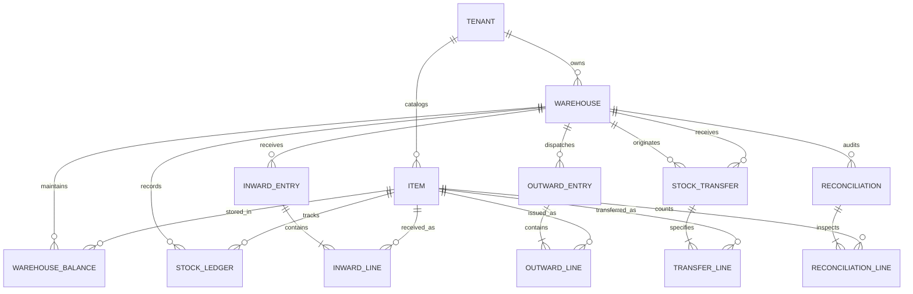

# ELVA ERP — Inventory Module Data Model

> **Module**: Inventory Management  
> **Schema Design**: Multi-tenant, Relational, Audit-Immutable

---

## 1. Entity Relationship Diagram

---

## 2. Core Entities & Attributes

### 2.1 Item Master (`items`)
Primary catalog of materials, raw goods, switchgear, and cables.

| Attribute | Type | Nullable | Description |
|---|---|---|---|
| `id` | `VARCHAR(36)` | NO | Primary Key (UUID) |
| `tenantId` | `VARCHAR(36)` | NO | Multi-tenant identifier |
| `itemCode` | `VARCHAR(64)` | NO | Unique SKU / Part number (e.g. `CBL-1.5-3C`) |
| `itemName` | `VARCHAR(255)` | NO | Descriptive item name |
| `category` | `VARCHAR(64)` | NO | Cables, Switchgear, Conduit, Earthing, Meters, Transformers |
| `unit` | `VARCHAR(20)` | NO | Mtr, Nos, Set, Kg, Box, Roll, Packet, Ltr |
| `hsnCode` | `VARCHAR(16)` | YES | Harmonized System of Nomenclature code |
| `currentStock` | `DECIMAL(14,3)`| NO | Consolidated company-wide available quantity |
| `reorderLevel` | `DECIMAL(14,3)`| NO | Minimum safety stock before alert triggered |
| `taxRate` | `DECIMAL(5,2)` | NO | GST rate percentage (e.g. 18.00) |
| `status` | `VARCHAR(32)` | NO | "In Stock", "Low Stock", "Out of Stock", "Reorder" |
| `createdAt` | `TIMESTAMP` | NO | Creation ISO timestamp |
| `updatedAt` | `TIMESTAMP` | NO | Last modification timestamp |

---

### 2.2 Warehouse (`warehouses`)
Storage locations, yards, depot sites, and project stores.

| Attribute | Type | Nullable | Description |
|---|---|---|---|
| `id` | `VARCHAR(36)` | NO | Primary Key (UUID) |
| `tenantId` | `VARCHAR(36)` | NO | Multi-tenant identifier |
| `code` | `VARCHAR(32)` | NO | Location code (e.g. `PUN-MAIN-01`) |
| `name` | `VARCHAR(128)` | NO | Descriptive warehouse name |
| `streetAddress`| `VARCHAR(255)` | NO | Street and physical plot details |
| `city` | `VARCHAR(64)` | NO | City location |
| `state` | `VARCHAR(64)` | NO | State (e.g. Maharashtra) |
| `pinCode` | `VARCHAR(12)` | NO | Postal pin code |
| `type` | `VARCHAR(32)` | NO | "Main", "Yard", "Site", "Transit", "Depot" |
| `totalAreaSqFt`| `INTEGER` | NO | Total warehouse footprint in square feet |
| `zonesCount` | `INTEGER` | NO | Number of physical storage bays/zones |
| `capacityUtilization` | `INTEGER` | NO | Current percentage capacity occupancy |
| `contactPerson`| `VARCHAR(128)` | YES| Site manager / store in-charge |
| `contactPhone` | `VARCHAR(32)` | YES| Contact mobile number |
| `status` | `VARCHAR(32)` | NO | "Active", "Inactive", "Maintenance" |

---

### 2.3 Warehouse Balance (`warehouse_balances`)
Composite breakdown of stock per item per specific warehouse location.

| Attribute | Type | Nullable | Constraints |
|---|---|---|---|
| `warehouseId` | `VARCHAR(36)` | NO | FK to `warehouses.id` |
| `itemId` | `VARCHAR(36)` | NO | FK to `items.id` |
| `quantity` | `DECIMAL(14,3)`| NO | `CHECK (quantity >= 0)` (Enforces zero negative stock) |
| `valuation` | `DECIMAL(16,2)`| NO | Current weighted holding valuation |
| `lastMovement` | `TIMESTAMP` | YES| Timestamp of last inward or outward action |

---

### 2.4 Stock Ledger (`stock_ledger`)
Immutable historical audit trail of all physical material movements.

| Attribute | Type | Nullable | Description |
|---|---|---|---|
| `id` | `VARCHAR(36)` | NO | Primary Key |
| `tenantId` | `VARCHAR(36)` | NO | Tenant isolation |
| `date` | `DATE` | NO | Transaction posting date |
| `voucherNo` | `VARCHAR(64)` | NO | External document ref (GRN-..., DN-..., ST-..., REC-...) |
| `type` | `VARCHAR(32)` | NO | "Inward", "Outward", "Transfer", "Adjustment" |
| `itemId` | `VARCHAR(36)` | NO | Target item reference |
| `warehouseId` | `VARCHAR(36)` | NO | Target warehouse location |
| `quantityIn` | `DECIMAL(14,3)`| NO | Inflow quantity (0 if outward) |
| `quantityOut` | `DECIMAL(14,3)`| NO | Outflow quantity (0 if inward) |
| `balance` | `DECIMAL(14,3)`| NO | Running available balance immediately after posting |
| `reference` | `VARCHAR(255)` | YES| Originating supplier, PO, site project, or transfer note |
| `userId` | `VARCHAR(64)` | NO | Operator user who authorized transaction |
| `createdAt` | `TIMESTAMP` | NO | Server transaction timestamp |

---

## 3. Units of Measure (UOM) Handling

Inventory items support the standard units defined in the ELVA ERP platform:
- `Mtr` (Metres) — Primarily used for electrical cables and conduits.
- `Nos` (Numbers / Count) — Switchgear, transformers, meters, distribution boards.
- `Kg` (Kilograms) — Bulk raw metals and bonding chemicals.
- `Set` — Matched earthing kits and pre-wired junction boxes.
- `Box` / `Roll` / `Packet` — Packaging and bulk fast-moving items.

All stock arithmetic is calculated in high-precision decimal (`DECIMAL(14,3)`) to eliminate floating-point rounding errors during unit conversions.

