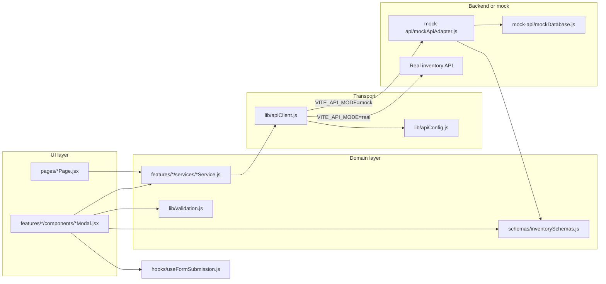

# Inventory Module — Frontend Architecture & File Map

This document explains **why each important file exists**, **who imports it**, and how **pages → services → API transport → schemas → mock** connect. Use it alongside:

| Doc | Role |
|-----|------|
| [backend-api-contract.md](./backend-api-contract.md) | Human-readable REST contract for backend teams |
| [data-model.md](./data-model.md) | Entity relationships and field semantics |
| [mock-vs-production.md](./mock-vs-production.md) | Mock vs real behaviour and deployment expectations |
| [implementation-decisions.md](./implementation-decisions.md) | Boundaries (e.g. DN vs invoice stock impact) |
| [color-code.md](./color-code.md) | Design tokens used in `src/index.css` |
| [../README.md](../README.md) | How to run, env vars, high-level overview |

---

## 1. End-to-end request flow

The UI never calls `fetch` directly from pages. Every data operation goes through a **feature service**, then **`apiClient`**, which either simulates HTTP in mock mode or performs real HTTP in real mode.

**Entry chain:** `index.html` → `src/main.jsx` (fonts + CSS) → `src/App.jsx` (hash router + shell) → `src/pages/*` → `src/features/*/services/*` → `src/lib/apiClient.js`.

---

## 2. Environment and API mode

| File | Purpose |
|------|---------|
| `.env` | **Active** Vite env (not committed). Copy from `.env.example`. Restart `npm run dev` after changes. |
| `.env.example` | Template only; editing it does **not** change runtime. |
| `src/lib/apiConfig.js` | Reads `VITE_API_MODE` (`mock` \| `real`) and `VITE_API_BASE_URL` (default `http://localhost:3000/api/inventory`). Also `VITE_TENANT_NAME` / `VITE_TENANT_SUBTITLE`. Tests can override via `setApiModeOverride` / `setApiBaseUrlOverride`. |

**Important path note:** Services use **relative paths** like `/items`, `/inward`. In **real** mode, `apiClient` prefixes them with `VITE_API_BASE_URL`. The written contract in [backend-api-contract.md](./backend-api-contract.md) documents `/api/v1/inventory` — align the base URL env var with whatever the deployed gateway exposes (e.g. `https://api.example.com/api/v1/inventory`).

In **mock** mode, `mockApiAdapter` strips a leading `/api/inventory` segment internally but accepts the same logical paths the services send.

---

## 3. Routing and app shell

| File | Why it exists | Linked from | Links to |
|------|---------------|-------------|----------|
| `src/hooks/useHashRoute.js` | Hash-based SPA routing (`#/dashboard`, `#/warehouse-detail?warehouseId=…`) without a router package | `App.jsx` | Used by pages via `route` / `onNavigate` props |
| `src/config/navigation.js` | Single source for `ROUTES`, `DEFAULT_ROUTE`, sidebar `NAV_SECTIONS` (icons + labels) | `App.jsx`, `Sidebar.jsx` | Lucide icons only |
| `src/App.jsx` | Maps route → page component, login vs authenticated shell, toast host, warehouse detail query param | `main.jsx` | All `pages/*`, `AppShell`, `useHashRoute`, `navigation.js` |
| `src/pages/LoginPage.jsx` | Sign-in screen (mock login → navigate to dashboard) | `App.jsx` | No services (local only) |
| `src/components/layout/AppShell.jsx` | Page chrome: sidebar + top bar + main slot | `App.jsx` | `Sidebar`, `TopBar` |
| `src/components/layout/Sidebar.jsx` | Nav from `NAV_SECTIONS`; highlights `activeNavKey` from `App.jsx` | `AppShell` | `navigation.js`, `useHashRoute.buildHref` |
| `src/components/layout/TopBar.jsx` | Title, search placeholder, mobile menu, user menu | `AppShell` | `UserMenu` |
| `src/components/layout/UserMenu.jsx` | Avatar dropdown (mock user) | `TopBar` | `UserIdentity`, `features/auth/mockUser.js` |
| `src/components/layout/UserIdentity.jsx` | Name / role display | `UserMenu`, optionally elsewhere | `mockUser.js` |
| `src/components/brand/BrandMark.jsx` | “Inventory & Stock” branding in sidebar | `Sidebar` | `assets/Elva.svg` |
| `src/features/auth/mockUser.js` | Static user for demo header until IAM is wired | `UserMenu`, `UserIdentity` | — |

---

## 4. Pages → services → modals

Each screen loads data with **AbortSignal**-friendly service calls and opens **feature modals** for creates.

| Page | Route (`ROUTES.*`) | Services used | Modal(s) |
|------|-------------------|---------------|----------|
| `DashboardPage.jsx` | `dashboard` | `dashboardService` | — |
| `ItemMasterPage.jsx` | `itemMaster` | `itemService` | `AddItemModal` |
| `WarehouseDashboardPage.jsx` | `warehouses` | `warehouseService` | `AddWarehouseModal` |
| `WarehouseDetailPage.jsx` | `warehouseDetail` | `warehouseService` | — (`warehouseId` from hash query) |
| `StockLedgerPage.jsx` | `stockLedger` | `ledgerService`, `itemService`, `warehouseService` | — |
| `InwardPage.jsx` | `inward` | `inwardService`, `itemService`, `warehouseService` | `AddInwardModal` |
| `OutwardPage.jsx` | `outward` | `outwardService`, `itemService`, `warehouseService` | `AddOutwardModal` |
| `StockTransferPage.jsx` | `stockTransfer` | `transferService`, `warehouseService`, `itemService` | `CreateTransferModal` |
| `StockAgingPage.jsx` | `stockAging` | `agingService`, `warehouseService` | — |
| `StockReconciliationPage.jsx` | `stockReconciliation` | `reconciliationService`, `warehouseService`, `itemService` | `StartReconciliationModal` |
| `SalesInvoicesPage.jsx` | `salesInvoice` | `invoiceService`, `itemService` | `CreateInvoiceModal` |
| `DeliveryNotesPage.jsx` | `deliveryNote` | `deliveryNoteService`, `invoiceService`, `warehouseService` | `CreateDeliveryNoteModal` |

**Shared page props** (from `App.jsx`): `route`, `onNavigate`, `onShowToast`; plus `warehouseId` on warehouse detail.

---

## 5. Feature services (API surface used by the UI)

All services import `apiRequest` (and `createIdempotencyKey` for POSTs) from `src/lib/apiClient.js`. Paths below are the **service path** segment appended to the configured base URL.

| Service file | Exported API | HTTP (typical) |
|--------------|--------------|----------------|
| `features/dashboard/services/dashboardService.js` | `getDashboardMetrics()` | `GET /dashboard` |
| `features/items/services/itemService.js` | `getItems`, `getItemById`, `createItem`, `updateItem` | `GET/POST/PATCH /items` |
| `features/warehouses/services/warehouseService.js` | `getWarehouses`, `getWarehouseById`, `createWarehouse` | `GET/POST /warehouses` |
| `features/inward/services/inwardService.js` | `getInwardEntries`, `getInwardById`, `createInward` | `GET/POST /inward` |
| `features/outward/services/outwardService.js` | `getOutwardEntries`, `getOutwardById`, `createOutward` | `GET/POST /outward` |
| `features/ledger/services/ledgerService.js` | `getLedger` | `GET /ledger` |
| `features/transfers/services/transferService.js` | `getTransfers`, `createTransfer` | `GET/POST /transfers` |
| `features/aging/services/agingService.js` | `getAgingAnalysis` | `GET /aging` |
| `features/reconciliation/services/reconciliationService.js` | `getReconciliations`, `startReconciliation` | `GET/POST /reconciliations` |
| `features/invoices/services/invoiceService.js` | `getInvoices`, `createInvoice` | `GET/POST /invoices` |
| `features/delivery-notes/services/deliveryNoteService.js` | `getDeliveryNotes`, `createDeliveryNote` | `GET/POST /delivery-notes` |

**Contract mapping:** Each row should have a matching section in [backend-api-contract.md](./backend-api-contract.md). The mock adapter implements the same paths for local development ([mock-vs-production.md](./mock-vs-production.md)).

---

## 6. Schemas (`src/schemas/inventorySchemas.js`)

**Why:** Single Zod source for entity shapes, enums, and **create** payloads. Keeps mock validation, tests, and (where used) UI parsing aligned with [data-model.md](./data-model.md).

| Schema export | Used by UI | Used by mock | Used by tests |
|---------------|------------|--------------|---------------|
| `CreateItemInputSchema` | `AddItemModal` (`safeParse` before POST) | `createItem` | `inventorySchemas.test.js` |
| `CreateWarehouseInputSchema` | `AddWarehouseModal` | `createWarehouse` | same |
| `CreateInwardInputSchema` | — (modal uses custom `validate` + manual payload) | `createInward` | same |
| `CreateOutwardInputSchema` | — (custom validate in modal) | `createOutward` | same |
| `CreateTransferInputSchema` | — (legacy modal form) | `createTransfer` | same |
| `StartReconciliationInputSchema` | — | `startReconciliation` | same |
| `CreateDeliveryNoteInputSchema` | — | `createDeliveryNote` | same |
| `CreateInvoiceInputSchema` | — | `createInvoice` | same |
| `InventoryItemSchema`, `WarehouseSchema`, … | — (response/documentation) | parse/validate responses in mock | entity tests |

**Enums** in the same file (`ItemCategoryEnum`, `WarehouseStatusEnum`, etc.) mirror domain vocab for Zod and documentation; modals may duplicate option lists in JSX until fully driven from schema enums.

---

## 7. Mock API layer

| File | Why | Connections |
|------|-----|-------------|
| `src/mock-api/mockDatabase.js` | In-memory seeded DB (items, warehouses, transactions, ledger). `resetMockDatabase()` / `getMockDatabase()` for tests | Imported by `mockApiAdapter.js`; mutated on every successful mock mutation |
| `src/mock-api/mockApiAdapter.js` | Implements `handleRequest(path, { method, query, body, idempotencyKey })` — route table + business rules (stock checks, ledger writes, idempotency) | Lazy-loaded from `apiClient` when `isMockMode()`; validates POST bodies with `Create*InputSchema` from `inventorySchemas.js` |

Mock mode **never** falls through to HTTP. Real mode **never** falls back to mock (`apiClient.test.js` asserts this).

---

## 8. `src/lib/` — shared non-UI utilities

| File | Purpose | Imported by |
|------|---------|-------------|
| `apiClient.js` | `apiRequest`, `ApiError`, `createIdempotencyKey`, `UNAUTHORIZED_EVENT`, mock adapter registration | All `*Service.js`, `useFormSubmission.js`, tests |
| `apiConfig.js` | Mode and base URL from env + test overrides | `apiClient.js`, tests |
| `validation.js` | Lightweight form helpers (`isBlank`, `isPositiveDecimal`, `exceedsDecimal`) for line-item modals | `AddInwardModal`, `AddOutwardModal`, similar |
| `formatters.js` | Placeholder for shared date/currency formatters (currently empty; pages/modals inline formatting) | — |

---

## 9. `src/hooks/`

| File | Purpose | Imported by |
|------|---------|-------------|
| `useHashRoute.js` | Hash routing + `navigate` + query params | `App.jsx` |
| `useFormSubmission.js` | Modal form state: validate → submit → map `ApiError.fieldErrors`; stable idempotency key per open | `AddItemModal`, `AddWarehouseModal`, `AddInwardModal`, `AddOutwardModal` |

---

## 10. UI components (`src/components/`)

### Layout & brand

Already covered in §3 (`AppShell`, `Sidebar`, `TopBar`, `UserMenu`, `UserIdentity`, `BrandMark`).

### Shared UI (`components/ui/`)

| File | Why | Typical consumers |
|------|-----|-------------------|
| `Modal.jsx` | Native `<dialog>` wrapper, focus trap pattern | All modals |
| `ModalForm.jsx` | Footer actions + error banner via `describeError` | Procurement-style modals |
| `FormField.jsx`, `FormFields.jsx`, `formStyles.js` | Consistent labels/inputs | Modals, some pages |
| `PrimaryActionButton.jsx`, `OutlineButton.jsx` | Action styling | Pages (list headers) |
| `DataTable.jsx` | Table + loading/empty/error via `AsyncState` | List pages |
| `AsyncState.jsx` | `LoadingState`, `ErrorState`, `EmptyState`, `ResourceBoundary` | `DataTable`, `DashboardPage` |
| `errorMessages.js` | Maps `ApiError` kinds to user-facing copy | `AsyncState`, `ModalForm` |
| `Panel.jsx`, `StatCard.jsx`, `SummaryCards.jsx` | Dashboard / KPI layout | `DashboardPage`, others |
| `Badge.jsx`, `badgeStyles.js` | Status chips | Tables, detail views |
| `FilterSelect.jsx`, `SearchInput.jsx`, `SelectInput.jsx`, `StatusTabs.jsx`, `Pagination.jsx`, `ListFooter.jsx` | List filtering and paging | Transaction list pages |
| `LineItemsEditor.jsx` | Dynamic rows for inward/outward line items | `AddInwardModal`, `AddOutwardModal` |
| `ProgressBar.jsx` | Utilization bars | Warehouse views |
| `Toast.jsx` | Global toast host | `App.jsx` |
| `MockModeBadge.jsx` | Optional dev badge for mock mode | **Not wired** in `App.jsx` today; available if you want visible mode indicator |

---

## 11. Feature modals (detail)

| Modal | Service on submit | Client validation | Zod on submit |
|-------|-------------------|-------------------|---------------|
| `features/items/components/AddItemModal.jsx` | `itemService.createItem` | via `CreateItemInputSchema.safeParse` | Yes |
| `features/warehouses/components/AddWarehouseModal.jsx` | `warehouseService.createWarehouse` | via `CreateWarehouseInputSchema` | Yes |
| `features/inward/components/AddInwardModal.jsx` | `inwardService.createInward` | `lib/validation.js` + custom `validate()` | Mock validates with Zod |
| `features/outward/components/AddOutwardModal.jsx` | `outwardService.createOutward` | same pattern as inward | Mock validates with Zod |
| `features/transfers/components/CreateTransferModal.jsx` | `transferService.createTransfer` | Legacy inline form (UI parity in progress) | Mock only |
| `features/reconciliation/components/StartReconciliationModal.jsx` | `reconciliationService.startReconciliation` | Legacy inline form | Mock only |
| `features/invoices/components/CreateInvoiceModal.jsx` | `invoiceService.createInvoice` | Legacy inline form | Mock only |
| `features/delivery-notes/components/CreateDeliveryNoteModal.jsx` | `deliveryNoteService.createDeliveryNote` | Legacy inline form | Mock only |

---

## 12. Root / build files

| File | Role |
|------|------|
| `index.html` | Vite HTML shell, `#root` mount |
| `src/main.jsx` | React root, Inter variable font, global CSS |
| `src/index.css` | Tailwind v4 theme tokens (workspace colors, components) |
| `src/assets/Elva.svg` | Logo asset |
| `vite.config.js` | Vite + Vitest (`tests/setup.js`) |
| `package.json` | `dev`, `build`, `test`, `preview` scripts |
| `figma-screenshots/` | Design reference PNGs (not imported by code) |

---

## 13. Tests (`tests/`)

| File | What it proves | Main dependencies |
|------|----------------|-------------------|
| `setup.js` | Vitest DOM, React global, `<dialog>.showModal` mock | Loaded from `vite.config.js` |
| `inventorySchemas.test.js` | Zod accept/reject for all `Create*InputSchema` and core entities | `inventorySchemas.js` |
| `apiClient.test.js` | Idempotency keys; mock intercept returns data; real mode does not silently use mock | `apiClient.js`, `apiConfig.js` |
| `stockIntegrity.test.js` | Mock business rules: inward increases stock, outward blocked when insufficient, transfers conserve stock, etc. | `mockApiAdapter.js`, `mockDatabase.js` |
| `workflows.test.jsx` | Smoke render of key pages against mock API (dashboard KPIs, item list, warehouses, ledger) | Page components + mock via default test env |

Run: `npm test` from `apps/frontend/inventory-module/`.

---

## 14. Quick “where do I change X?”

| Goal | Start here |
|------|------------|
| Add a new screen | `navigation.js` → `App.jsx` `PAGES` → new `pages/*Page.jsx` → optional `features/*/services` |
| Change API path or headers | `*Service.js` paths + [backend-api-contract.md](./backend-api-contract.md) + real backend |
| Change validation rules for creates | `inventorySchemas.js` + mock handler + `inventorySchemas.test.js`; wire modal if needed |
| Change mock seed data | `mockDatabase.js` |
| Change stock/ledger behaviour in dev | `mockApiAdapter.js` (+ `stockIntegrity.test.js`) |
| Switch mock ↔ real | `.env` `VITE_API_MODE` and `VITE_API_BASE_URL`, restart dev server |
| Match Procurement modal UX | `ModalForm`, `useFormSubmission`, `FormFields` (see Item/Warehouse/Inward/Outward modals) |

---

## 15. Related modules in the monorepo

This package is **self-contained** under `apps/frontend/inventory-module/`. It does not import the Procurement app at runtime; UI patterns were copied to match ELVA Procurement. For how Procurement runs its demo vs main app, see the Procurement module README — Inventory uses a **single Vite app** with env-driven mock/real instead of a separate demo port.
